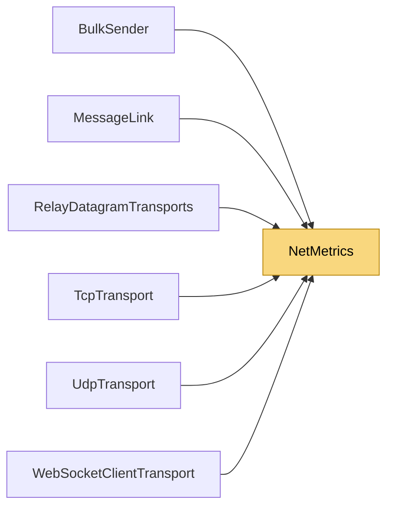

# NetMetrics

> [!info] Generated by `tools/generate-vault.py` from the source — do not edit by hand; rerun the script after code changes.

Per-connection counters. All writes go through `Interlocked` so the metrics can be read from any thread while network threads update them.

**Namespace** `NetSync.Diagnostics` · **Folder** [[Module map Diagnostics|Diagnostics]] · **Layer** Foundation

**Source** `src/NetSync/Diagnostics/NetMetrics.cs`

## Types

| Type | Kind | Summary |
|---|---|---|
| `NetMetrics` | public sealed class | Per-connection counters. All writes go through `Interlocked` so the metrics can be read from any thread while network threads update them. |

## Members

**NetMetrics**

- `public long BytesSent`
- `public long BytesReceived`
- `public long PacketsSent`
- `public long PacketsReceived`
- `public long FragmentsSent`
- `public long FragmentsReceived`
- `public long PacketsReassembled`
- `public long PingTimeouts`
- `public int SendQueueSize`
- `public int MaxSendQueueSize`
- `internal void AddBytesSent(long count)`
- `internal void AddBytesReceived(long count)`
- `internal void IncrementPacketsSent()`
- `internal void IncrementPacketsReceived()`
- `internal void IncrementFragmentsSent()`
- `internal void IncrementFragmentsReceived()`
- `internal void IncrementPacketsReassembled()`
- `internal void IncrementPingTimeouts()`
- `internal void UpdateSendQueueSize(int size)`
- `public override string ToString()`

## Depends on (0)

—

## Used by (6)

- **Transports**: [[BulkSender]], [[MessageLink]]
- **Transports/Tcp**: [[TcpTransport]]
- **Transports/Udp**: [[UdpTransport]]
- **Transports/WebSockets**: [[WebSocketClientTransport]]
- **Relay**: [[RelayDatagramTransports]]

## Neighbourhood

