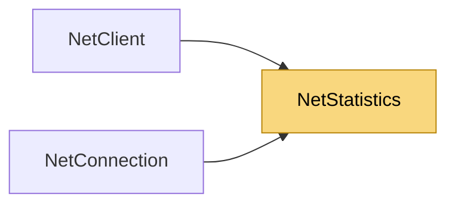

# NetStatistics

> [!info] Generated by `tools/generate-vault.py` from the source — do not edit by hand; rerun the script after code changes.

Point-in-time snapshot of a connection's traffic, as seen by the application: message counts and payload bytes (before compression/encryption), plus the reliability engine's view of the link.

**Namespace** `NetSync.Diagnostics` · **Folder** [[Module map Diagnostics|Diagnostics]] · **Layer** Foundation

**Source** `src/NetSync/Diagnostics/NetStatistics.cs`

## Types

| Type | Kind | Summary |
|---|---|---|
| `NetStatistics` | public sealed class | Point-in-time snapshot of a connection's traffic, as seen by the application: message counts and payload bytes (before compression/encryption), plus the reliability engine's view of the link. |
| `TrafficCounters` | internal sealed class | Lock-free counters behind `NetStatistics`. |

## Members

**NetStatistics**

- `public long MessagesSent`
- `public long MessagesReceived`
- `public long BytesSent`
- `public long BytesReceived`
- `public long Retransmissions`
- `public long FastRetransmissions`
- `public int PingMs`
- `public double SmoothedRttMs`
- `public long DroppedEvents`
- `public bool IsDegraded`
- `public override string ToString()`

**TrafficCounters**

- `public void OnSent(int bytes)`
- `public void OnReceived(int bytes)`
- `public void CopyTo(NetStatistics statistics)`

## Depends on (0)

—

## Used by (2)

- **Peers**: [[NetClient]] (`NetStatistics`, `TrafficCounters`), [[NetConnection]] (`NetStatistics`, `TrafficCounters`)

## Neighbourhood

