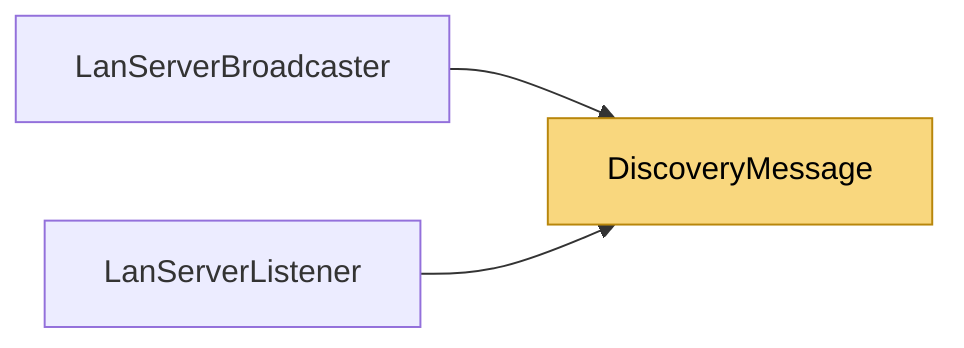

# DiscoveryMessage

> [!info] Generated by `tools/generate-vault.py` from the source — do not edit by hand; rerun the script after code changes.

LAN discovery datagram: v2 [magic "NSD2":4][serverPort:2 BE][appIdLen:1][appId utf8][payloadLen:2 BE][payload] v1 [magic "NSD1":4][serverPort:2 BE][appIdLen:1][appId utf8] (still understood) The appId keeps unrelated NetSync applications on the same network apart; the payload is the application's own description of the server (name, map, players…).

**Namespace** `NetSync.Discovery` · **Folder** [[Module map Discovery|Discovery]] · **Layer** API

**Source** `src/NetSync/Discovery/DiscoveryMessage.cs`

## Types

| Type | Kind | Summary |
|---|---|---|
| `DiscoveryMessage` | internal static class | LAN discovery datagram: v2 [magic "NSD2":4][serverPort:2 BE][appIdLen:1][appId utf8][payloadLen:2 BE][payload] v1 [magic "NSD1":4][serverPort:2 BE][appIdLen:1][appId utf8] (still understood) The appId keeps unrelated… |

## Members

**DiscoveryMessage**

- `public const int MaxAppIdBytes = 255`
- `public const int MaxPayloadBytes = 1024`
- `public static byte[] Encode(string appId, int serverPort, ReadOnlySpan<byte> payload = default)`
- `public static bool TryDecode(ReadOnlySpan<byte> datagram, out string appId, out int serverPort)`
- `public static bool TryDecode(ReadOnlySpan<byte> datagram, out string appId, out int serverPort, out byte[] payload)`

## Depends on (0)

—

## Used by (2)

- **Discovery**: [[LanServerBroadcaster]], [[LanServerListener]]

## Neighbourhood

