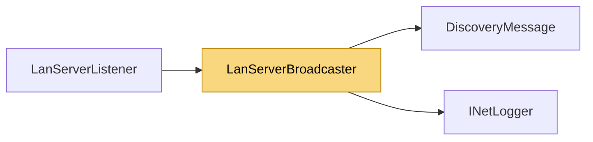

# LanServerBroadcaster

> [!info] Generated by `tools/generate-vault.py` from the source — do not edit by hand; rerun the script after code changes.

Announces a server on the local network: periodically broadcasts a discovery datagram on every IPv4 LAN interface (Ethernet/Wi-Fi). The Unity-free replacement for the 1.x LocalNetworkBroadcaster.

**Namespace** `NetSync.Discovery` · **Folder** [[Module map Discovery|Discovery]] · **Layer** API

**Source** `src/NetSync/Discovery/LanServerBroadcaster.cs`

## Types

| Type | Kind | Summary |
|---|---|---|
| `LanServerBroadcaster` | public sealed class | Announces a server on the local network: periodically broadcasts a discovery datagram on every IPv4 LAN interface (Ethernet/Wi-Fi). The Unity-free replacement for the 1.x LocalNetworkBroadcaster. |

## Extends / implements

- `LanServerBroadcaster` → `IDisposable`

## Members

**LanServerBroadcaster**

- `public const int DefaultDiscoveryPort = 47777`
- `public byte[] Payload`
- `internal IPEndPoint? TargetOverride`
- `public LanServerBroadcaster(string appId, int serverPort, int discoveryPort = DefaultDiscoveryPort,`
- `public void Start()`
- `public void Stop()`
- `public void Dispose()`

## Depends on (2)

- **Discovery**: [[DiscoveryMessage]]
- **Diagnostics**: [[INetLogger]] (`INetLogger`, `NullNetLogger`)

## Used by (1)

- **Discovery**: [[LanServerListener]]

## Neighbourhood

