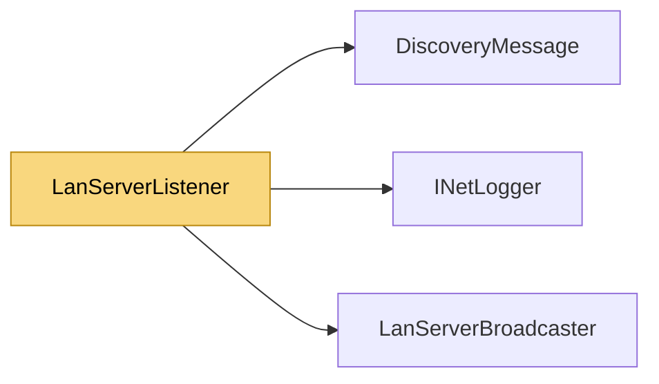

# LanServerListener

> [!info] Generated by `tools/generate-vault.py` from the source — do not edit by hand; rerun the script after code changes.

Listens for `LanServerBroadcaster` announcements and raises `ServerFound` with the server's connectable endpoint. The event fires on a background thread and keeps firing for every announcement received — stop the listener once connected.

**Namespace** `NetSync.Discovery` · **Folder** [[Module map Discovery|Discovery]] · **Layer** API

**Source** `src/NetSync/Discovery/LanServerListener.cs`

## Types

| Type | Kind | Summary |
|---|---|---|
| `DiscoveredServer` | public sealed class | A server heard on the LAN. |
| `LanServerListener` | public sealed class | Listens for `LanServerBroadcaster` announcements and raises `ServerFound` with the server's connectable endpoint. The event fires on a background thread and keeps firing for every announcement received — stop the… |

## Extends / implements

- `LanServerListener` → `IDisposable`

## Members

**DiscoveredServer**

- `public IPEndPoint EndPoint`
- `public byte[] Payload`
- `internal DiscoveredServer(IPEndPoint endPoint, byte[] payload)`
- `public override string ToString()`

**LanServerListener**

- `public int Port`
- `public event Action<IPEndPoint>? ServerFound`
- `public event Action<DiscoveredServer>? ServerDiscovered`
- `public LanServerListener(string appId, int discoveryPort = LanServerBroadcaster.DefaultDiscoveryPort, INetLogger? logger = null)`
- `public void Start()`
- `public void Stop()`
- `public void Dispose()`

## Depends on (3)

- **Discovery**: [[DiscoveryMessage]], [[LanServerBroadcaster]]
- **Diagnostics**: [[INetLogger]] (`INetLogger`, `NullNetLogger`)

## Used by (0)

—

## Neighbourhood

