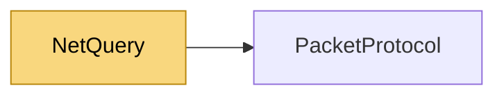

# NetQuery

> [!info] Generated by `tools/generate-vault.py` from the source — do not edit by hand; rerun the script after code changes.

Connectionless request/response with a NetSync server's UDP port: ask a server for its name, map, player count… without connecting. The server answers through `QueryHandler`.

**Namespace** `NetSync.Discovery` · **Folder** [[Module map Discovery|Discovery]] · **Layer** API

**Source** `src/NetSync/Discovery/NetQuery.cs`

## Types

| Type | Kind | Summary |
|---|---|---|
| `NetQueryResult` | public sealed class | A reply to `QueryAsync`. |
| `NetQuery` | public static class | Connectionless request/response with a NetSync server's UDP port: ask a server for its name, map, player count… without connecting. The server answers through `QueryHandler`. |

## Members

**NetQueryResult**

- `public byte[] Response`
- `public double RoundTripMs`
- `internal NetQueryResult(byte[] response, double roundTripMs)`

**NetQuery**

- `public const int MaxResponseSize = 1200`
- `public static async Task<NetQueryResult> QueryAsync(IPEndPoint server, ReadOnlyMemory<byte> request, int maxResponseSize = 512,`

## Depends on (1)

- **Transports**: [[PacketProtocol]] (`PacketType`)

## Used by (0)

—

## Neighbourhood

