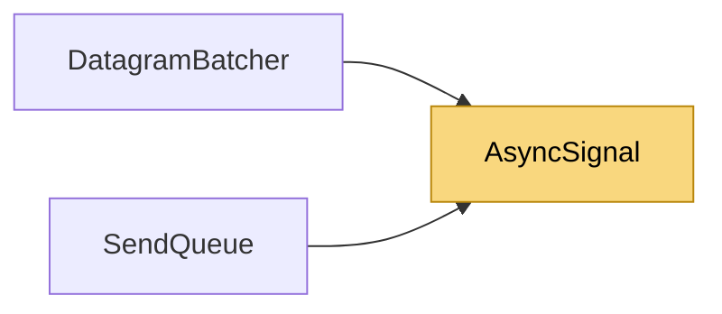

# AsyncSignal

> [!info] Generated by `tools/generate-vault.py` from the source — do not edit by hand; rerun the script after code changes.

Allocation-free auto-reset signal for exactly one async waiter. A Set() that arrives while nobody waits is remembered (one pending wake-up); a Set() during a wait completes it. Replaces SemaphoreSlim.WaitAsync in drain loops: the semaphore allocates a task node for every wait that suspends — once per message in request/response traffic. The waiter resumes on the thread pool, never inline in Set(): a producer only pays for the enqueue, and while the consumer is busy, producers keep adding work it can batch. When the waiter is an async method (the drain loops), .NET queues its state machine to the pool directly — no allocation for the hop either.

**Namespace** `NetSync.Internal` · **Folder** [[Module map Internal|Internal]] · **Layer** Foundation

**Source** `src/NetSync/Internal/AsyncSignal.cs`

## Types

| Type | Kind | Summary |
|---|---|---|
| `AsyncSignal` | internal sealed class | Allocation-free auto-reset signal for exactly one async waiter. A Set() that arrives while nobody waits is remembered (one pending wake-up); a Set() during a wait completes it. Replaces SemaphoreSlim.WaitAsync in… |

## Extends / implements

- `AsyncSignal` → `IValueTaskSource`

## Members

**AsyncSignal**

- `public AsyncSignal()`
- `public void Set()`
- `public ValueTask WaitAsync()`

## Depends on (0)

—

## Used by (2)

- **Transports/Udp**: [[DatagramBatcher]]
- **Sending**: [[SendQueue]]

## Neighbourhood

