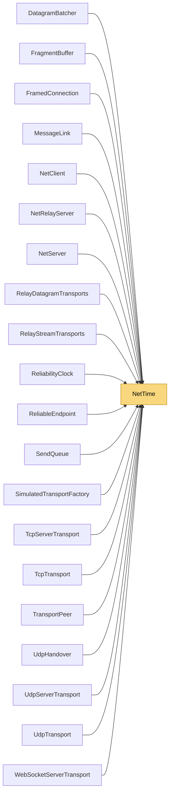

# NetTime

> [!NOTE]
> Generated by `tools/generate-vault.py` from the source — do not edit by hand; rerun the script after code changes.

Monotonic clock. DateTime.UtcNow is not monotonic (NTP jumps, DST issues on some platforms) and must not be used for RTT or timeout measurement.

**Namespace** `NetSync.Internal` · **Folder** [Internal](../../4%20Diagrams/Modules/Module%20map%20Internal.md) · **Layer** Foundation

**Source** `src/NetSync/Internal/NetTime.cs`

## Types

| Type | Kind | Summary |
|---|---|---|
| `NetTime` | internal static class | Monotonic clock. DateTime.UtcNow is not monotonic (NTP jumps, DST issues on some platforms) and must not be used for RTT or timeout measurement. |

## Members

**NetTime**

- `public static long NowMs`
- `public static double PreciseMs`

## Depends on (0)

—

## Used by (20)

- **Peers**: [NetClient](../Peers/NetClient.md), [NetServer](../Peers/NetServer.md), [UdpHandover](../Peers/UdpHandover.md)
- **Pipeline/Reliability**: [ReliabilityClock](../Pipeline/Reliability/ReliabilityClock.md), [ReliableEndpoint](../Pipeline/Reliability/ReliableEndpoint.md)
- **Transports**: [MessageLink](../Transports/MessageLink.md), [TransportPeer](../Transports/TransportPeer.md)
- **Transports/Tcp**: [TcpServerTransport](../Transports/Tcp/TcpServerTransport.md), [TcpTransport](../Transports/Tcp/TcpTransport.md)
- **Transports/Udp**: [DatagramBatcher](../Transports/Udp/DatagramBatcher.md), [UdpServerTransport](../Transports/Udp/UdpServerTransport.md), [UdpTransport](../Transports/Udp/UdpTransport.md)
- **Transports/WebSockets**: [WebSocketServerTransport](../Transports/WebSockets/WebSocketServerTransport.md)
- **Transports/Simulation**: [SimulatedTransportFactory](../Transports/Simulation/SimulatedTransportFactory.md)
- **Relay**: [FramedConnection](../Relay/FramedConnection.md), [NetRelayServer](../Relay/NetRelayServer.md), [RelayDatagramTransports](../Relay/RelayDatagramTransports.md), [RelayStreamTransports](../Relay/RelayStreamTransports.md)
- **Sending**: [SendQueue](../Sending/SendQueue.md)
- **Pipeline/Fragmentation**: [FragmentBuffer](../Pipeline/Fragmentation/FragmentBuffer.md)

## Neighbourhood

