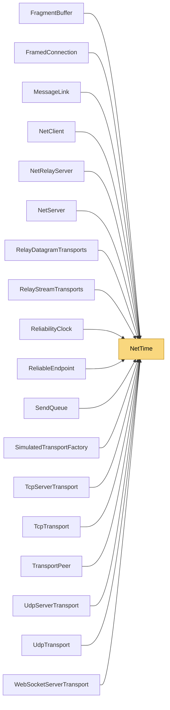

# NetTime

> [!info] Generated by `tools/generate-vault.py` from the source — do not edit by hand; rerun the script after code changes.

Monotonic clock. DateTime.UtcNow is not monotonic (NTP jumps, DST issues on some platforms) and must not be used for RTT or timeout measurement.

**Namespace** `NetSync.Internal` · **Folder** [[Module map Internal|Internal]] · **Layer** Foundation

**Source** `src/NetSync/Internal/NetTime.cs`

## Types

| Type | Kind | Summary |
|---|---|---|
| `NetTime` | internal static class | Monotonic clock. DateTime.UtcNow is not monotonic (NTP jumps, DST issues on some platforms) and must not be used for RTT or timeout measurement. |

## Members

**NetTime**

- `public static long NowMs`
- `public static double PreciseMs`

## Depends on (0)

—

## Used by (18)

- **Peers**: [[NetClient]], [[NetServer]]
- **Pipeline/Reliability**: [[ReliabilityClock]], [[ReliableEndpoint]]
- **Transports**: [[MessageLink]], [[TransportPeer]]
- **Transports/Tcp**: [[TcpServerTransport]], [[TcpTransport]]
- **Transports/Udp**: [[UdpServerTransport]], [[UdpTransport]]
- **Transports/WebSockets**: [[WebSocketServerTransport]]
- **Transports/Simulation**: [[SimulatedTransportFactory]]
- **Relay**: [[FramedConnection]], [[NetRelayServer]], [[RelayDatagramTransports]], [[RelayStreamTransports]]
- **Sending**: [[SendQueue]]
- **Pipeline/Fragmentation**: [[FragmentBuffer]]

## Neighbourhood

