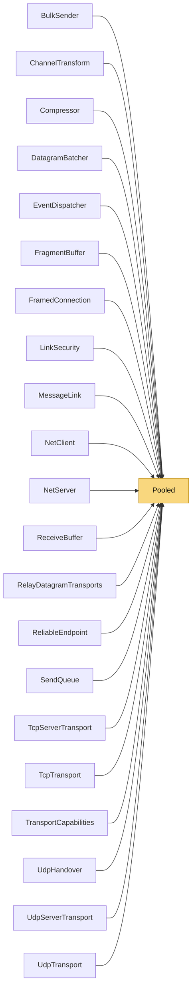

# Pooled

> [!NOTE]
> Generated by `tools/generate-vault.py` from the source — do not edit by hand; rerun the script after code changes.

The one buffer pool of the library. Rented arrays are usually longer than asked for — always carry the length alongside, never use array.Length.

**Namespace** `NetSync.Internal` · **Folder** [Internal](../../4%20Diagrams/Modules/Module%20map%20Internal.md) · **Layer** Foundation

**Source** `src/NetSync/Internal/Pooled.cs`

## Types

| Type | Kind | Summary |
|---|---|---|
| `Pooled` | internal static class | The one buffer pool of the library. Rented arrays are usually longer than asked for — always carry the length alongside, never use array.Length. |

## Members

**Pooled**

- `public static byte[] Rent(int minimumLength)`
- `public static void Return(byte[] buffer)`
- `public static byte[] Copy(ReadOnlySpan<byte> source)`
- `public static byte[] ToArray(byte[] buffer, int offset, int count)`

## Depends on (0)

—

## Used by (21)

- **Peers**: [ChannelTransform](../Peers/ChannelTransform.md), [EventDispatcher](../Peers/EventDispatcher.md), [NetClient](../Peers/NetClient.md), [NetServer](../Peers/NetServer.md), [UdpHandover](../Peers/UdpHandover.md)
- **Pipeline/Reliability**: [ReliableEndpoint](../Pipeline/Reliability/ReliableEndpoint.md)
- **Pipeline/Security**: [LinkSecurity](../Pipeline/Security/LinkSecurity.md)
- **Pipeline/Compression**: [Compressor](../Pipeline/Compression/Compressor.md)
- **Transports**: [BulkSender](../Transports/BulkSender.md), [MessageLink](../Transports/MessageLink.md), [ReceiveBuffer](../Transports/ReceiveBuffer.md), [TransportCapabilities](../Transports/TransportCapabilities.md)
- **Transports/Tcp**: [TcpServerTransport](../Transports/Tcp/TcpServerTransport.md), [TcpTransport](../Transports/Tcp/TcpTransport.md)
- **Transports/Udp**: [DatagramBatcher](../Transports/Udp/DatagramBatcher.md), [UdpServerTransport](../Transports/Udp/UdpServerTransport.md), [UdpTransport](../Transports/Udp/UdpTransport.md)
- **Relay**: [FramedConnection](../Relay/FramedConnection.md), [RelayDatagramTransports](../Relay/RelayDatagramTransports.md)
- **Sending**: [SendQueue](../Sending/SendQueue.md)
- **Pipeline/Fragmentation**: [FragmentBuffer](../Pipeline/Fragmentation/FragmentBuffer.md)

## Neighbourhood

