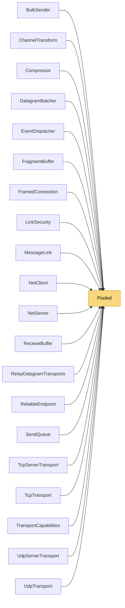

# Pooled

> [!info] Generated by `tools/generate-vault.py` from the source — do not edit by hand; rerun the script after code changes.

The one buffer pool of the library. Rented arrays are usually longer than asked for — always carry the length alongside, never use array.Length.

**Namespace** `NetSync.Internal` · **Folder** [[Module map Internal|Internal]] · **Layer** Foundation

**Source** `src/NetSync/Internal/Pooled.cs`

## Types

| Type | Kind | Summary |
|---|---|---|
| `Pooled` | internal static class | The one buffer pool of the library. Rented arrays are usually longer than asked for — always carry the length alongside, never use array.Length. |

## Members

**Pooled**

- `public static byte[] Rent(int minimumLength)`
- `public static void Return(byte[] buffer)`
- `public static byte[] Copy(ReadOnlySpan<byte> source)`
- `public static byte[] ToArray(byte[] buffer, int offset, int count)`

## Depends on (0)

—

## Used by (20)

- **Peers**: [[ChannelTransform]], [[EventDispatcher]], [[NetClient]], [[NetServer]]
- **Pipeline/Reliability**: [[ReliableEndpoint]]
- **Pipeline/Security**: [[LinkSecurity]]
- **Pipeline/Compression**: [[Compressor]]
- **Transports**: [[BulkSender]], [[MessageLink]], [[ReceiveBuffer]], [[TransportCapabilities]]
- **Transports/Tcp**: [[TcpServerTransport]], [[TcpTransport]]
- **Transports/Udp**: [[DatagramBatcher]], [[UdpServerTransport]], [[UdpTransport]]
- **Relay**: [[FramedConnection]], [[RelayDatagramTransports]]
- **Sending**: [[SendQueue]]
- **Pipeline/Fragmentation**: [[FragmentBuffer]]

## Neighbourhood

