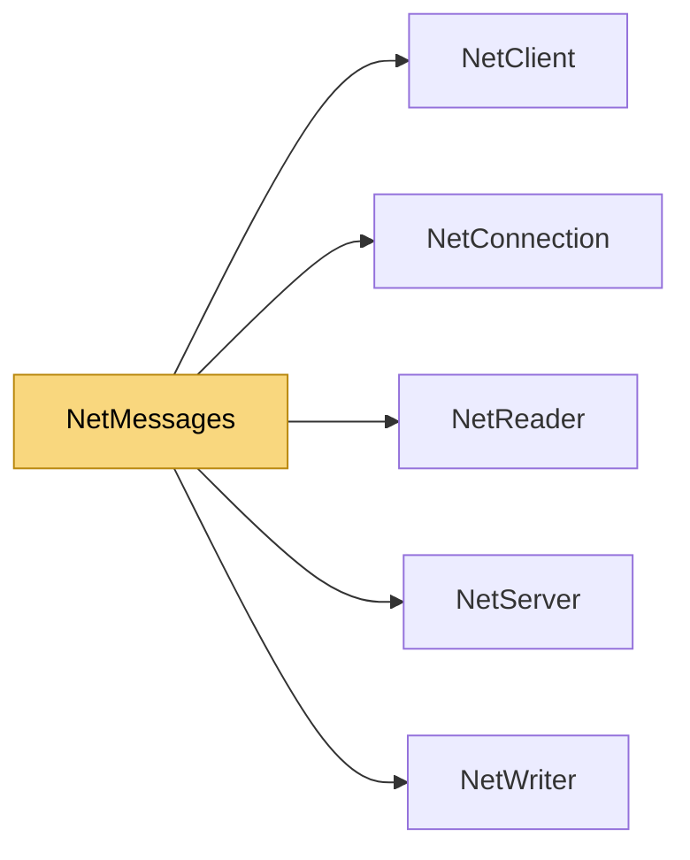

# NetMessages

> [!info] Generated by `tools/generate-vault.py` from the source — do not edit by hand; rerun the script after code changes.

A message type: knows how to write itself to and read itself from the binary stream. Classes or structs; no reflection involved, IL2CPP/AOT safe. Struct messages are received without any allocation; a class message costs one object per message. Read() must copy what it keeps — the reader's bytes are only valid during the handler.

**Namespace** `NetSync.Messaging` · **Folder** [[Module map Messaging|Messaging]] · **Layer** API

**Source** `src/NetSync/Messaging/NetMessages.cs`

## Types

| Type | Kind | Summary |
|---|---|---|
| `INetMessage` | public interface | A message type: knows how to write itself to and read itself from the binary stream. Classes or structs; no reflection involved, IL2CPP/AOT safe. Struct messages are received without any allocation; a class message… |
| `NetMessageRegistry` | public sealed class | Maps message types to wire ids. Build one registry and share it between client and server (same ids on both sides). Wire format: [id: var-uint][body]. |
| `MessageDispatcher<TSender>` | internal sealed class | Shared dispatch logic for the client- and server-side messengers. Allocation-free per message: handler lists are copy-on-write arrays and readers are reused per thread. |
| `NetClientMessenger` | public sealed class | Typed messages on top of a `NetClient`: Handlers run where the client raises DataReceived (PollEvents caller in Polled mode). |
| `NetServerMessenger` | public sealed class | Typed messages on top of a `NetServer`; handlers get the sending connection. |

## Extends / implements

- `NetClientMessenger` → `IDisposable`
- `NetServerMessenger` → `IDisposable`

## Members

**NetMessageRegistry**

- `public NetMessageRegistry Register<T>(uint id) where T : INetMessage, new()`
- `public bool IsRegistered<T>()`
- `internal uint GetId<T>()`
- `internal bool IsKnown(uint id)`
- `public ReadOnlyMemory<byte> Serialize<T>(T message) where T : INetMessage`
- `internal void WriteTo<T>(NetWriter writer, T message) where T : INetMessage`
- `internal ValueTask SendWith<T, TTarget>(T message, TTarget target, Func<TTarget, ReadOnlyMemory<byte>, ValueTask> send)`

**MessageDispatcher**

- `public event Action<TSender, uint>? UnknownMessage`
- `public event Action<TSender, Exception>? MalformedMessage`
- `public MessageDispatcher(NetMessageRegistry registry)`
- `public void On<T>(Action<TSender, T> handler) where T : INetMessage, new()`
- `public void Dispatch(TSender sender, ReadOnlyMemory<byte> data)`

**NetClientMessenger**

- `public event Action<uint>? UnknownMessage`
- `public event Action<Exception>? MalformedMessage`
- `public NetClientMessenger(NetClient client, NetMessageRegistry registry, params byte[] channels)`
- `public void On<T>(Action<T> handler) where T : INetMessage, new()`
- `public ValueTask SendAsync<T>(byte channel, T message, CancellationToken ct = default) where T : INetMessage`
- `public void Dispose()`

**NetServerMessenger**

- `public event Action<NetConnection, uint>? UnknownMessage`
- `public event Action<NetConnection, Exception>? MalformedMessage`
- `public NetServerMessenger(NetServer server, NetMessageRegistry registry, params byte[] channels)`
- `public void On<T>(Action<NetConnection, T> handler) where T : INetMessage, new()`
- `public ValueTask SendAsync<T>(NetConnection connection, byte channel, T message, CancellationToken ct = default) where T : INetMessage`
- `public Task BroadcastAsync<T>(byte channel, T message, CancellationToken ct = default) where T : INetMessage`
- `public void Dispose()`

## Depends on (5)

- **Peers**: [[NetClient]], [[NetConnection]], [[NetServer]]
- **Serialization**: [[NetReader]], [[NetWriter]]

## Used by (0)

—

## Neighbourhood

