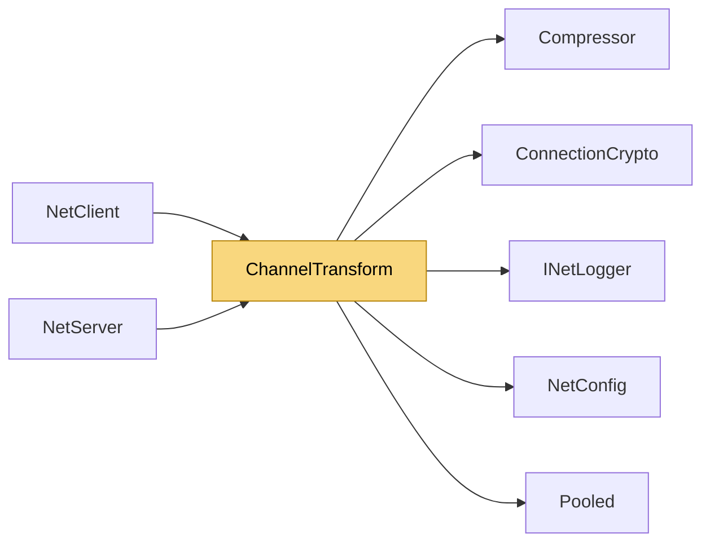

# ChannelTransform

> [!info] Generated by `tools/generate-vault.py` from the source — do not edit by hand; rerun the script after code changes.

Per-channel payload pipeline: compress, then encrypt (compressing ciphertext is pointless). Runs before reliability/fragmentation, which treat the result as opaque bytes. Channels with neither feature skip this entirely — the extra flags byte only exists on channels that opted in. Results come back in pooled buffers (the caller returns them). Encryption is allocation-free on net8.0; compression works in pooled buffers too, but the Deflate stream itself allocates — it is meant for bulk data. Transformed layout: [flags:1][body]

**Namespace** `NetSync.Peers` · **Folder** [[Module map Peers|Peers]] · **Layer** API

**Source** `src/NetSync/Peers/ChannelTransform.cs`

## Types

| Type | Kind | Summary |
|---|---|---|
| `ChannelTransform` | internal static class | Per-channel payload pipeline: compress, then encrypt (compressing ciphertext is pointless). Runs before reliability/fragmentation, which treat the result as opaque bytes. Channels with neither feature skip this… |

## Members

**ChannelTransform**

- `public const int MaxOverhead = 1 + 4 + 32`
- `public const int CompressionThreshold = 128`
- `public static byte[] Encode(ChannelConfig channel, ConnectionCrypto? crypto, ReadOnlySpan<byte> data, out int length)`
- `public static byte[]? Decode(ChannelConfig channel, ConnectionCrypto? crypto, byte[] buffer, int offset, int count, int maxMessageSize,`

## Depends on (5)

- **(root)**: [[NetConfig]] (`ChannelConfig`)
- **Pipeline/Security**: [[ConnectionCrypto]]
- **Pipeline/Compression**: [[Compressor]]
- **Diagnostics**: [[INetLogger]]
- **Internal**: [[Pooled]]

## Used by (2)

- **Peers**: [[NetClient]], [[NetServer]]

## Neighbourhood

