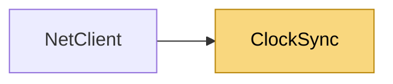

# ClockSync

> [!info] Generated by `tools/generate-vault.py` from the source — do not edit by hand; rerun the script after code changes.

Estimates the offset between this client's clock and the server's, NTP-style: each round trip gives offset = serverTime + rtt/2 − localReceiveTime, which is exact when both legs took equally long. The sample with the smallest RTT has the least room for asymmetry, so the estimate is the min-RTT sample of a small window — a congested round trip can't drag it off.

**Namespace** `NetSync.Peers` · **Folder** [[Module map Peers|Peers]] · **Layer** API

**Source** `src/NetSync/Peers/ClockSync.cs`

## Types

| Type | Kind | Summary |
|---|---|---|
| `ClockSync` | internal sealed class | Estimates the offset between this client's clock and the server's, NTP-style: each round trip gives offset = serverTime + rtt/2 − localReceiveTime, which is exact when both legs took equally long. The sample with the… |

## Members

**ClockSync**

- `public void AddSample(double clientSendMs, double serverTimeMs, double clientReceiveMs)`
- `public double ServerTimeMs(double localNowMs)`
- `public double AccuracyMs`

## Depends on (0)

—

## Used by (1)

- **Peers**: [[NetClient]]

## Neighbourhood

