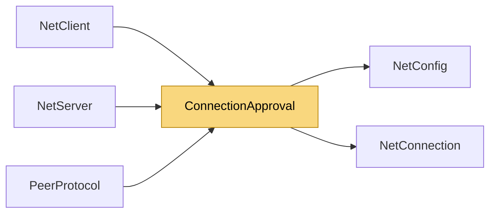

# ConnectionApproval

> [!info] Generated by `tools/generate-vault.py` from the source — do not edit by hand; rerun the script after code changes.

A client asking to join (see `ConnectionApprover`). The handshake is complete — keys established, server identity proven — but the connection isn't open yet: the application decides.

**Namespace** `NetSync.Peers` · **Folder** [[Module map Peers|Peers]] · **Layer** API

**Source** `src/NetSync/Peers/ConnectionApproval.cs`

## Types

| Type | Kind | Summary |
|---|---|---|
| `ConnectionRequest` | public sealed class | A client asking to join (see `ConnectionApprover`). The handshake is complete — keys established, server identity proven — but the connection isn't open yet: the application decides. |
| `ConnectionDecision` | public struct | The application's answer to a `ConnectionRequest`. |
| `ConnectionApprover` | public delegate | Decides whether a client may join. Runs on a network thread: keep it quick, or make it async (e.g. look the token up in a database) — the client waits up to `ConnectTimeoutMs`. Throwing rejects the client. |
| `ConnectionRejection` | public enum | Why a connect attempt was refused. |
| `ConnectionRejectedException` | public sealed class | The server refused the connection, or the client refused the server. |

## Extends / implements

- `ConnectionRejectedException` → `InvalidOperationException`

## Members

**ConnectionRequest**

- `public NetConnection Connection`
- `public ReadOnlyMemory<byte> ConnectData`
- `public IPEndPoint? RemoteEndPoint`
- `internal ConnectionRequest(NetConnection connection, ReadOnlyMemory<byte> connectData)`

**ConnectionDecision**

- `public const int MaxReasonBytes = 200`
- `public bool IsAccepted`
- `public string? RejectReason`
- `public static ConnectionDecision Accept()`
- `public static ConnectionDecision Reject(string reason)`
- `public static implicit operator ValueTask<ConnectionDecision>(ConnectionDecision decision)`

**ConnectionRejectedException**

- `public ConnectionRejection Rejection`
- `public string Reason`
- `public ConnectionRejectedException(ConnectionRejection rejection, string reason)`

## Depends on (2)

- **(root)**: [[NetConfig]] (`TransportType`)
- **Peers**: [[NetConnection]]

## Used by (3)

- **Peers**: [[NetClient]] (`ConnectionRejectedException`, `ConnectionRejection`), [[NetServer]] (`ConnectionApprover`, `ConnectionDecision`, `ConnectionRequest`), [[PeerProtocol]] (`ConnectionDecision`)

## Neighbourhood

