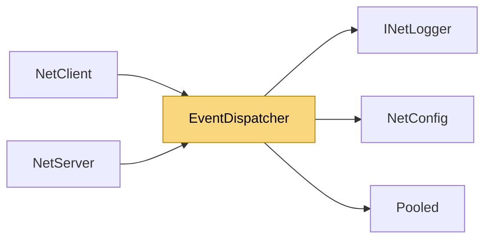

# EventDispatcher

> [!info] Generated by `tools/generate-vault.py` from the source — do not edit by hand; rerun the script after code changes.

Routes events either straight through (Immediate) or into a queue drained by PollEvents (Polled). Handler exceptions are logged, never propagated into network threads. Polled data events cost no allocation: the payload is copied into a pooled buffer and the queue holds plain structs in a reused ring (lifecycle events, which are rare, keep their closures). The Polled queue is bounded: if the application stops polling (paused game, forgotten call) data events beyond the cap are dropped with a warning instead of growing memory forever. Lifecycle events (connect/disconnect) are never dropped.

**Namespace** `NetSync.Peers` · **Folder** [[Module map Peers|Peers]] · **Layer** API

**Source** `src/NetSync/Peers/EventDispatcher.cs`

## Types

| Type | Kind | Summary |
|---|---|---|
| `IDataEventSink` | internal interface | Raises a queued data event; implemented by NetClient / NetServer. |
| `EventDispatcher` | internal sealed class | Routes events either straight through (Immediate) or into a queue drained by PollEvents (Polled). Handler exceptions are logged, never propagated into network threads. Polled data events cost no allocation: the… |
| ↳ `QueuedEvent` | private struct |  |

## Members

**EventDispatcher**

- `public bool IsImmediate`
- `public long DroppedEvents`
- `public EventDispatcher(EventDelivery mode, INetLogger logger, int maxPendingEvents = 100_000, IDataEventSink? sink = null)`
- `public void Dispatch(Action raise)`
- `public void DispatchData(Action raise)`
- `public void QueueData(object? source, byte channel, byte[] buffer, int offset, int count)`
- `public int Poll(int maxEvents)`

## Depends on (3)

- **(root)**: [[NetConfig]] (`EventDelivery`)
- **Diagnostics**: [[INetLogger]]
- **Internal**: [[Pooled]]

## Used by (2)

- **Peers**: [[NetClient]] (`EventDispatcher`, `IDataEventSink`), [[NetServer]] (`EventDispatcher`, `IDataEventSink`)

## Neighbourhood

