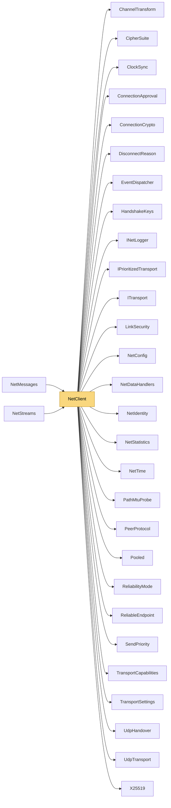

# NetClient

> [!NOTE]
> Generated by `tools/generate-vault.py` from the source — do not edit by hand; rerun the script after code changes.

**Namespace** `NetSync.Peers` · **Folder** [Peers](../../4%20Diagrams/Modules/Module%20map%20Peers.md) · **Layer** API

**Source** `src/NetSync/Peers/NetClient.Connect.cs` · `src/NetSync/Peers/NetClient.Services.cs` · `src/NetSync/Peers/NetClient.cs`

## Types

| Type | Kind | Summary |
|---|---|---|
| `NetClient` | public sealed class |  |
| ↳ `Session` | private sealed class |  |

## Members

**NetClient**

- `public long ConnectionId`
- `public bool IsConnected`
- `public bool IsDegraded`
- `public CipherSuite CipherSuite`
- `public byte[]? ServerIdentityKey`
- `public double ServerTimeMs`
- `public double ServerTimeAccuracyMs`
- `public NetStatistics Statistics`
- `public int PingMs`
- `public event Action? Connected`
- `public event Action<int>? Reconnecting`
- `public event Action? ReconnectFailed`
- `public event Action<DisconnectReason>? Disconnected`
- `public event NetDataHandler? MessageReceived`
- `public event Action<byte, byte[]>? DataReceived`
- `public NetClient(NetConfig config)`
- `public int GetPing(TransportType transport)`
- `public Task ConnectAsync(string host, int port, CancellationToken ct = default)`
- `public async Task ConnectAsync(string host, int port, ReadOnlyMemory<byte> connectData, CancellationToken ct = default)`
- `public Task ConnectAsync(IPEndPoint endpoint, CancellationToken ct = default)`
- `public Task ConnectAsync(IPEndPoint endpoint, ReadOnlyMemory<byte> connectData, CancellationToken ct = default)`
- `public ValueTask SendAsync(byte channel, ReadOnlyMemory<byte> data, CancellationToken ct = default)`
- `public int PollEvents(int maxEvents = int.MaxValue)`
- `public void Disconnect()`
- `public void Dispose()`

## Depends on (28)

- **(root)**: [NetConfig](../Root/NetConfig.md) (`ChannelConfig`, `EventDelivery`, `KeyExchangeMode`, `NetConfig`, `ReconnectPolicy`, `TransportType`)
- **Peers**: [ChannelTransform](ChannelTransform.md), [ClockSync](ClockSync.md), [ConnectionApproval](ConnectionApproval.md) (`ConnectionRejectedException`, `ConnectionRejection`), [EventDispatcher](EventDispatcher.md) (`EventDispatcher`, `IDataEventSink`), [NetDataHandlers](NetDataHandlers.md) (`NetDataHandler`), [PeerProtocol](PeerProtocol.md), [UdpHandover](UdpHandover.md)
- **Pipeline/Reliability**: [ReliabilityMode](../Pipeline/Reliability/ReliabilityMode.md), [ReliableEndpoint](../Pipeline/Reliability/ReliableEndpoint.md)
- **Pipeline/Security**: [CipherSuite](../Pipeline/Security/CipherSuite.md) (`CipherSuite`, `CipherSuites`), [ConnectionCrypto](../Pipeline/Security/ConnectionCrypto.md), [HandshakeKeys](../Pipeline/Security/HandshakeKeys.md), [LinkSecurity](../Pipeline/Security/LinkSecurity.md), [NetIdentity](../Pipeline/Security/NetIdentity.md), [X25519](../Pipeline/Security/X25519.md)
- **Transports**: [DisconnectReason](../Transports/DisconnectReason.md), [IPrioritizedTransport](../Transports/IPrioritizedTransport.md) (`IPrioritizedTransport`, `PriorityMapping`), [ITransport](../Transports/ITransport.md), [TransportCapabilities](../Transports/TransportCapabilities.md) (`IDatagramBoundaryTransport`, `IPooledReceiveTransport`), [TransportSettings](../Transports/TransportSettings.md)
- **Transports/Udp**: [PathMtuProbe](../Transports/Udp/PathMtuProbe.md), [UdpTransport](../Transports/Udp/UdpTransport.md)
- **Sending**: [SendPriority](../Sending/SendPriority.md)
- **Diagnostics**: [INetLogger](../Diagnostics/INetLogger.md), [NetStatistics](../Diagnostics/NetStatistics.md) (`NetStatistics`, `TrafficCounters`)
- **Internal**: [NetTime](../Internal/NetTime.md), [Pooled](../Internal/Pooled.md)

## Used by (2)

- **Messaging**: [NetMessages](../Messaging/NetMessages.md)
- **Streams**: [NetStreams](../Streams/NetStreams.md)

## Neighbourhood

