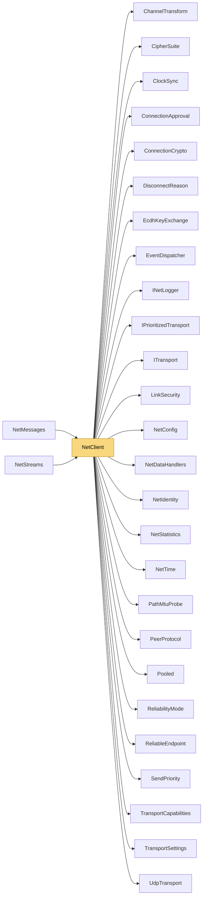

# NetClient

> [!info] Generated by `tools/generate-vault.py` from the source — do not edit by hand; rerun the script after code changes.

**Namespace** `NetSync.Peers` · **Folder** [[Module map Peers|Peers]] · **Layer** API

**Source** `src/NetSync/Peers/NetClient.Connect.cs` · `src/NetSync/Peers/NetClient.Services.cs` · `src/NetSync/Peers/NetClient.cs`

## Types

| Type | Kind | Summary |
|---|---|---|
| `NetClient` | public sealed class |  |
| ↳ `Session` | private sealed class |  |

## Members

**NetClient**

- `public long ConnectionId`
- `public bool IsConnected`
- `public bool IsDegraded`
- `public CipherSuite CipherSuite`
- `public byte[]? ServerIdentityKey`
- `public double ServerTimeMs`
- `public double ServerTimeAccuracyMs`
- `public NetStatistics Statistics`
- `public int PingMs`
- `public event Action? Connected`
- `public event Action<int>? Reconnecting`
- `public event Action? ReconnectFailed`
- `public event Action<DisconnectReason>? Disconnected`
- `public event NetDataHandler? MessageReceived`
- `public event Action<byte, byte[]>? DataReceived`
- `public NetClient(NetConfig config)`
- `public int GetPing(TransportType transport)`
- `public Task ConnectAsync(string host, int port, CancellationToken ct = default)`
- `public async Task ConnectAsync(string host, int port, ReadOnlyMemory<byte> connectData, CancellationToken ct = default)`
- `public Task ConnectAsync(IPEndPoint endpoint, CancellationToken ct = default)`
- `public Task ConnectAsync(IPEndPoint endpoint, ReadOnlyMemory<byte> connectData, CancellationToken ct = default)`
- `public ValueTask SendAsync(byte channel, ReadOnlyMemory<byte> data, CancellationToken ct = default)`
- `public int PollEvents(int maxEvents = int.MaxValue)`
- `public void Disconnect()`
- `public void Dispose()`

## Depends on (26)

- **(root)**: [[NetConfig]] (`ChannelConfig`, `EventDelivery`, `KeyExchangeMode`, `NetConfig`, `ReconnectPolicy`, `TransportType`)
- **Peers**: [[ChannelTransform]], [[ClockSync]], [[ConnectionApproval]] (`ConnectionRejectedException`, `ConnectionRejection`), [[EventDispatcher]] (`EventDispatcher`, `IDataEventSink`), [[NetDataHandlers]] (`NetDataHandler`), [[PeerProtocol]]
- **Pipeline/Reliability**: [[ReliabilityMode]], [[ReliableEndpoint]]
- **Pipeline/Security**: [[CipherSuite]] (`CipherSuite`, `CipherSuites`), [[ConnectionCrypto]], [[EcdhKeyExchange]], [[LinkSecurity]], [[NetIdentity]]
- **Transports**: [[DisconnectReason]], [[IPrioritizedTransport]] (`IPrioritizedTransport`, `PriorityMapping`), [[ITransport]], [[TransportCapabilities]] (`IDatagramBoundaryTransport`, `IPooledReceiveTransport`), [[TransportSettings]]
- **Transports/Udp**: [[PathMtuProbe]], [[UdpTransport]]
- **Sending**: [[SendPriority]]
- **Diagnostics**: [[INetLogger]], [[NetStatistics]] (`NetStatistics`, `TrafficCounters`)
- **Internal**: [[NetTime]], [[Pooled]]

## Used by (2)

- **Messaging**: [[NetMessages]]
- **Streams**: [[NetStreams]]

## Neighbourhood

