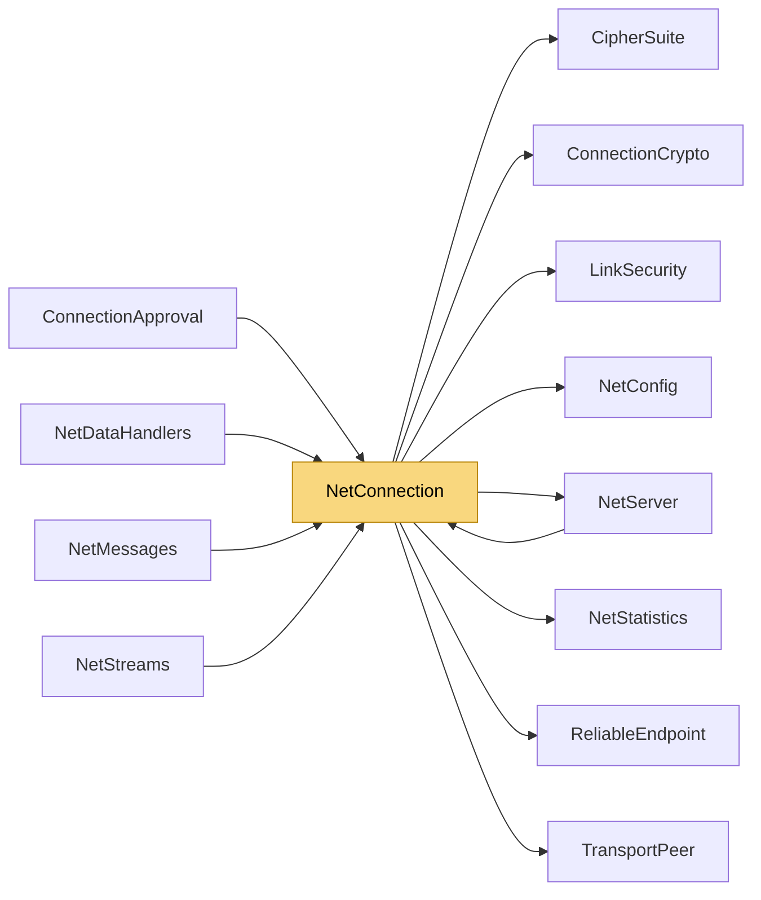

# NetConnection

> [!info] Generated by `tools/generate-vault.py` from the source — do not edit by hand; rerun the script after code changes.

A connected client as seen by `NetServer`: one logical connection spanning one transport link per configured transport type.

**Namespace** `NetSync.Peers` · **Folder** [[Module map Peers|Peers]] · **Layer** API

**Source** `src/NetSync/Peers/NetConnection.cs`

## Types

| Type | Kind | Summary |
|---|---|---|
| `NetConnection` | public sealed class | A connected client as seen by `NetServer`: one logical connection spanning one transport link per configured transport type. |

## Members

**NetConnection**

- `internal const int JoinNone = 0`
- `internal const int JoinPending = 1`
- `internal const int JoinAccepted = 2`
- `internal const int JoinRejected = 3`
- `internal readonly ConcurrentDictionary<TransportType, TransportPeer> Links = new ConcurrentDictionary<TransportType, TransportPeer>()`
- `internal readonly long Token`
- `internal readonly long CreatedAtMs`
- `internal ReliableEndpoint? Reliable`
- `internal ConnectionCrypto? Crypto`
- `internal readonly LinkSecurity?[] Security = new LinkSecurity?[2]`
- `internal byte[]? ClientPublicKey`
- `internal byte[] WelcomeMessage = Array.Empty<byte>()`
- `internal int JoinState`
- `internal int AuthRejectSent`
- `internal int Announced`
- `internal int Degraded`
- `internal int HoldsSlot`
- `public bool IsDegraded`
- `internal int Closed`
- `internal readonly Diagnostics.TrafficCounters Traffic = new Diagnostics.TrafficCounters()`
- `public object? Tag`
- `public CipherSuite CipherSuite`
- `public bool IsConnected`
- `public Diagnostics.NetStatistics Statistics`
- `public long Id`
- `internal NetConnection(NetServer server, long id, long token, long createdAtMs)`
- `public IPEndPoint? GetEndPoint(TransportType transport)`
- `public int GetPing(TransportType transport)`
- `public int PingMs`
- `public ValueTask SendAsync(byte channel, ReadOnlyMemory<byte> data, CancellationToken ct = default)`
- `public Task DisconnectAsync()`
- `public override string ToString()`

## Depends on (8)

- **(root)**: [[NetConfig]] (`TransportType`)
- **Peers**: [[NetServer]]
- **Pipeline/Reliability**: [[ReliableEndpoint]]
- **Pipeline/Security**: [[CipherSuite]], [[ConnectionCrypto]], [[LinkSecurity]]
- **Transports**: [[TransportPeer]]
- **Diagnostics**: [[NetStatistics]] (`NetStatistics`, `TrafficCounters`)

## Used by (5)

- **Peers**: [[ConnectionApproval]], [[NetDataHandlers]], [[NetServer]]
- **Messaging**: [[NetMessages]]
- **Streams**: [[NetStreams]]

## Neighbourhood

