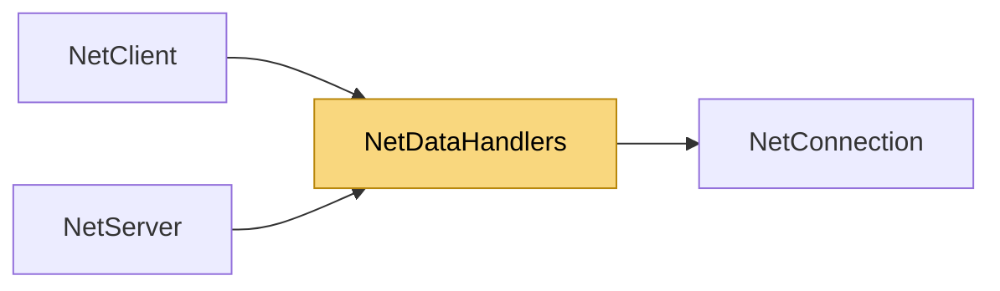

# NetDataHandlers

> [!info] Generated by `tools/generate-vault.py` from the source — do not edit by hand; rerun the script after code changes.

Zero-copy data handler for `MessageReceived`. `data` points into a pooled buffer and is valid only until the handler returns: parse it, pass it to SendAsync (which copies before returning), or copy it (`data.ToArray()`) if you need it later.

**Namespace** `NetSync.Peers` · **Folder** [[Module map Peers|Peers]] · **Layer** API

**Source** `src/NetSync/Peers/NetDataHandlers.cs`

## Types

| Type | Kind | Summary |
|---|---|---|
| `NetDataHandler` | public delegate | Zero-copy data handler for `MessageReceived`. `data` points into a pooled buffer and is valid only until the handler returns: parse it, pass it to SendAsync (which copies before returning), or copy it… |
| `NetConnectionDataHandler` | public delegate | Zero-copy data handler for `MessageReceived`; same lifetime rule as `NetDataHandler`. |

## Depends on (1)

- **Peers**: [[NetConnection]]

## Used by (2)

- **Peers**: [[NetClient]] (`NetDataHandler`), [[NetServer]] (`NetConnectionDataHandler`)

## Neighbourhood

