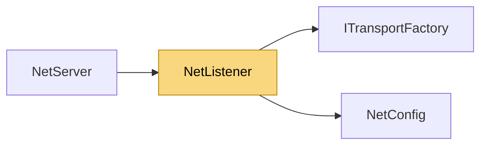

# NetListener

> [!info] Generated by `tools/generate-vault.py` from the source — do not edit by hand; rerun the script after code changes.

An extra transport a `NetServer` accepts clients on (see `AddListener`).

**Namespace** `NetSync.Peers` · **Folder** [[Module map Peers|Peers]] · **Layer** API

**Source** `src/NetSync/Peers/NetListener.cs`

## Types

| Type | Kind | Summary |
|---|---|---|
| `NetListener` | public sealed class | An extra transport a `NetServer` accepts clients on (see `AddListener`). |

## Members

**NetListener**

- `public TransportType Slot`
- `public int Port`
- `internal ITransportFactory Factory`
- `internal int RequestedPort`
- `internal NetListener(TransportType slot, ITransportFactory factory, int requestedPort)`
- `public override string ToString()`

## Depends on (2)

- **(root)**: [[NetConfig]] (`TransportType`)
- **Transports**: [[ITransportFactory]]

## Used by (1)

- **Peers**: [[NetServer]]

## Neighbourhood

