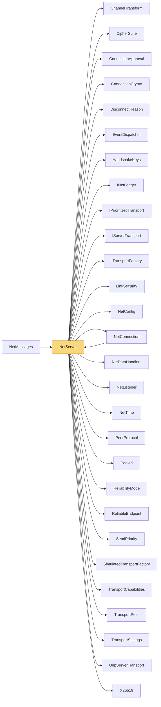

# NetServer

> [!NOTE]
> Generated by `tools/generate-vault.py` from the source — do not edit by hand; rerun the script after code changes.

**Namespace** `NetSync.Peers` · **Folder** [Peers](../../4%20Diagrams/Modules/Module%20map%20Peers.md) · **Layer** API

**Source** `src/NetSync/Peers/NetServer.Handshake.cs` · `src/NetSync/Peers/NetServer.cs`

## Types

| Type | Kind | Summary |
|---|---|---|
| `NetServer` | public sealed class |  |

## Members

**NetServer**

- `public const int MaxPendingConnections = 1024`
- `public int Port`
- `public bool IsRunning`
- `public double TimeMs`
- `public int ConnectionCount`
- `public IReadOnlyCollection<NetConnection> Connections`
- `public ConnectionApprover? ConnectionApprover`
- `public Func<System.Net.IPEndPoint, ReadOnlyMemory<byte>, byte[]?>? QueryHandler`
- `public event Action<NetConnection>? ConnectionOpened`
- `public event Action<NetConnection, DisconnectReason>? ConnectionClosed`
- `public event NetConnectionDataHandler? MessageReceived`
- `public event Action<NetConnection, byte, byte[]>? DataReceived`
- `public NetServer(NetConfig config)`
- `public NetListener AddListener(TransportType slot, ITransportFactory factory, int port)`
- `public async Task<int> StartAsync(int port, CancellationToken ct = default)`
- `internal ValueTask SendAsync(NetConnection connection, byte channel, ReadOnlyMemory<byte> data, CancellationToken ct = default)`
- `public async Task BroadcastAsync(byte channel, ReadOnlyMemory<byte> data, CancellationToken ct = default)`
- `internal async Task KickAsync(NetConnection connection, bool kicked)`
- `public int PollEvents(int maxEvents = int.MaxValue)`
- `public async Task StopAsync()`
- `public void Dispose()`

## Depends on (28)

- **(root)**: [NetConfig](../Root/NetConfig.md) (`ChannelConfig`, `EventDelivery`, `KeyExchangeMode`, `NetConfig`, `TransportType`)
- **Peers**: [ChannelTransform](ChannelTransform.md), [ConnectionApproval](ConnectionApproval.md) (`ConnectionApprover`, `ConnectionDecision`, `ConnectionRequest`), [EventDispatcher](EventDispatcher.md) (`EventDispatcher`, `IDataEventSink`), [NetConnection](NetConnection.md), [NetDataHandlers](NetDataHandlers.md) (`NetConnectionDataHandler`), [NetListener](NetListener.md), [PeerProtocol](PeerProtocol.md)
- **Pipeline/Reliability**: [ReliabilityMode](../Pipeline/Reliability/ReliabilityMode.md), [ReliableEndpoint](../Pipeline/Reliability/ReliableEndpoint.md)
- **Pipeline/Security**: [CipherSuite](../Pipeline/Security/CipherSuite.md) (`CipherSuite`, `CipherSuites`), [ConnectionCrypto](../Pipeline/Security/ConnectionCrypto.md), [HandshakeKeys](../Pipeline/Security/HandshakeKeys.md), [LinkSecurity](../Pipeline/Security/LinkSecurity.md), [X25519](../Pipeline/Security/X25519.md)
- **Transports**: [DisconnectReason](../Transports/DisconnectReason.md), [IPrioritizedTransport](../Transports/IPrioritizedTransport.md) (`IPrioritizedServerTransport`, `PriorityMapping`), [IServerTransport](../Transports/IServerTransport.md), [ITransportFactory](../Transports/ITransportFactory.md), [TransportCapabilities](../Transports/TransportCapabilities.md) (`IDatagramBoundaryServerTransport`, `IPeerFlushingServerTransport`, `IPooledReceiveServerTransport`, `ITrustAwareServerTransport`), [TransportPeer](../Transports/TransportPeer.md), [TransportSettings](../Transports/TransportSettings.md)
- **Transports/Udp**: [UdpServerTransport](../Transports/Udp/UdpServerTransport.md)
- **Transports/Simulation**: [SimulatedTransportFactory](../Transports/Simulation/SimulatedTransportFactory.md) (`IWrappedServerTransport`, `SimulatedTransportFactory`)
- **Sending**: [SendPriority](../Sending/SendPriority.md)
- **Diagnostics**: [INetLogger](../Diagnostics/INetLogger.md)
- **Internal**: [NetTime](../Internal/NetTime.md), [Pooled](../Internal/Pooled.md)

## Used by (2)

- **Peers**: [NetConnection](NetConnection.md)
- **Messaging**: [NetMessages](../Messaging/NetMessages.md)

## Neighbourhood

