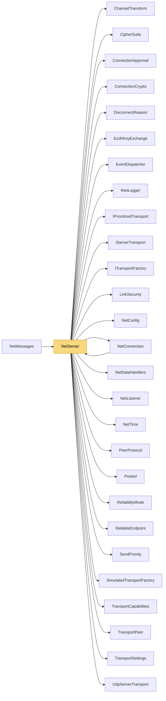

# NetServer

> [!info] Generated by `tools/generate-vault.py` from the source — do not edit by hand; rerun the script after code changes.

**Namespace** `NetSync.Peers` · **Folder** [[Module map Peers|Peers]] · **Layer** API

**Source** `src/NetSync/Peers/NetServer.Handshake.cs` · `src/NetSync/Peers/NetServer.cs`

## Types

| Type | Kind | Summary |
|---|---|---|
| `NetServer` | public sealed class |  |

## Members

**NetServer**

- `public const int MaxPendingConnections = 1024`
- `public int Port`
- `public bool IsRunning`
- `public double TimeMs`
- `public int ConnectionCount`
- `public IReadOnlyCollection<NetConnection> Connections`
- `public ConnectionApprover? ConnectionApprover`
- `public Func<System.Net.IPEndPoint, ReadOnlyMemory<byte>, byte[]?>? QueryHandler`
- `public event Action<NetConnection>? ConnectionOpened`
- `public event Action<NetConnection, DisconnectReason>? ConnectionClosed`
- `public event NetConnectionDataHandler? MessageReceived`
- `public event Action<NetConnection, byte, byte[]>? DataReceived`
- `public NetServer(NetConfig config)`
- `public NetListener AddListener(TransportType slot, ITransportFactory factory, int port)`
- `public async Task<int> StartAsync(int port, CancellationToken ct = default)`
- `internal ValueTask SendAsync(NetConnection connection, byte channel, ReadOnlyMemory<byte> data, CancellationToken ct = default)`
- `public async Task BroadcastAsync(byte channel, ReadOnlyMemory<byte> data, CancellationToken ct = default)`
- `internal async Task KickAsync(NetConnection connection, bool kicked)`
- `public int PollEvents(int maxEvents = int.MaxValue)`
- `public async Task StopAsync()`
- `public void Dispose()`

## Depends on (27)

- **(root)**: [[NetConfig]] (`ChannelConfig`, `EventDelivery`, `KeyExchangeMode`, `NetConfig`, `TransportType`)
- **Peers**: [[ChannelTransform]], [[ConnectionApproval]] (`ConnectionApprover`, `ConnectionDecision`, `ConnectionRequest`), [[EventDispatcher]] (`EventDispatcher`, `IDataEventSink`), [[NetConnection]], [[NetDataHandlers]] (`NetConnectionDataHandler`), [[NetListener]], [[PeerProtocol]]
- **Pipeline/Reliability**: [[ReliabilityMode]], [[ReliableEndpoint]]
- **Pipeline/Security**: [[CipherSuite]] (`CipherSuite`, `CipherSuites`), [[ConnectionCrypto]], [[EcdhKeyExchange]], [[LinkSecurity]]
- **Transports**: [[DisconnectReason]], [[IPrioritizedTransport]] (`IPrioritizedServerTransport`, `PriorityMapping`), [[IServerTransport]], [[ITransportFactory]], [[TransportCapabilities]] (`IDatagramBoundaryServerTransport`, `IPooledReceiveServerTransport`, `ITrustAwareServerTransport`), [[TransportPeer]], [[TransportSettings]]
- **Transports/Udp**: [[UdpServerTransport]]
- **Transports/Simulation**: [[SimulatedTransportFactory]] (`IWrappedServerTransport`, `SimulatedTransportFactory`)
- **Sending**: [[SendPriority]]
- **Diagnostics**: [[INetLogger]]
- **Internal**: [[NetTime]], [[Pooled]]

## Used by (2)

- **Peers**: [[NetConnection]]
- **Messaging**: [[NetMessages]]

## Neighbourhood

