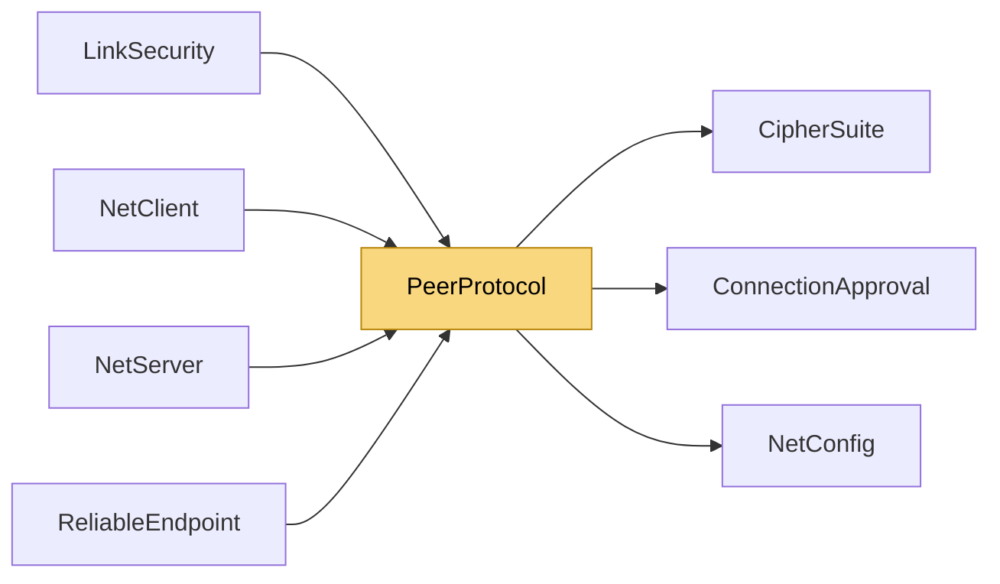

# PeerProtocol

> [!info] Generated by `tools/generate-vault.py` from the source — do not edit by hand; rerun the script after code changes.

Peer-level messages, carried inside transport Data payloads. Handshake (plaintext): Hello [0x01][ver=3][token:8][configHash:4][keyExchange:1][suites:1][pubLen:1][pub…][cookieLen:1][cookie…] — client introduces itself on every link; the token groups the links into one connection, configHash covers the channel table and MaxMessageSize, suites is the bitmask of cipher suites the client can run. Welcome [0x02][connectionId:8][suite:1][pubLen:1][pub…][idLen:1][identityKey…][sigLen:1][signature…] — server bound the link; ECDH public key, and when the server has an identity its public key plus a signature over the handshake transcript. Reject [0x03][reason:1] — handshake refused (version/encryption/config/auth). Retry [0x06][cookie:16] — UDP-only servers: prove your address, resend Hello with this cookie. Session (inside the authenticated envelope on encrypted connections): Join [0x07][connectData…] — client: open the connection (data encrypted when keyed). JoinAccept [0x08] — server: connection open. JoinReject [0x09][reason utf8…] — server application refused. Bye [0x04][reason:1] — graceful disconnect notice. Degrade [0x05] — client (on TCP): "UDP failed, carry my UDP channels over TCP". TimeReq [0x0A][clientTime:8] — client: what time is it on the server? TimeResp [0x0B][clientTime:8][serverTime:8] — server: echo + its clock (double ms, bit pattern BE). PathMtu [0x0C][datagramSize:2] — client: the measured path MTU; use it for fragments too. Data [0x10][channel:1][payload…] — application data. RelData / RelAck — reliability layer (see ReliableEndpoint). Secure [0x40][counter:8][tag:16][inner…] — authenticated envelope (see LinkSecurity).

**Namespace** `NetSync.Peers` · **Folder** [[Module map Peers|Peers]] · **Layer** API

**Source** `src/NetSync/Peers/PeerProtocol.cs`

## Types

| Type | Kind | Summary |
|---|---|---|
| `PeerProtocol` | internal static class | Peer-level messages, carried inside transport Data payloads. Handshake (plaintext): Hello [0x01][ver=3][token:8][configHash:4][keyExchange:1][suites:1][pubLen:1][pub…][cookieLen:1][cookie…] — client introduces itself… |
| ↳ `Hello` | internal struct |  |
| ↳ `Welcome` | internal struct |  |

## Members

**PeerProtocol**

- `public const byte ProtocolVersion = 3`
- `public const byte MsgHello = 0x01`
- `public const byte MsgWelcome = 0x02`
- `public const byte MsgReject = 0x03`
- `public const byte MsgBye = 0x04`
- `public const byte MsgDegrade = 0x05`
- `public const byte MsgRetry = 0x06`
- `public const byte MsgJoin = 0x07`
- `public const byte MsgJoinAccept = 0x08`
- `public const byte MsgJoinReject = 0x09`
- `public const byte MsgTimeRequest = 0x0A`
- `public const byte MsgTimeResponse = 0x0B`
- `public const byte MsgPathMtu = 0x0C`
- `public const byte MsgSecure = 0x40`
- `public const byte MsgData = 0x10`
- `public const byte MsgRelData = 0x20`
- `public const byte MsgRelAck = 0x21`
- `public const int DataHeaderSize = 2`
- `public const int CookieSize = 16`
- `public const int MaxConnectDataSize = 4096`
- `public const byte RejectVersionMismatch = 1`
- `public const byte RejectEncryptionMismatch = 2`
- `public const byte RejectConfigMismatch = 3`
- `public const byte RejectAuthenticationFailed = 4`
- `public const byte ByeGraceful = 0`
- `public const byte ByeKicked = 1`
- `public static byte[] EncodeHello(long token, uint configHash, KeyExchangeMode keyExchange, byte suites,`
- `public static bool TryReadHelloVersion(ReadOnlySpan<byte> message, out byte version)`
- `public static bool TryParseHello(byte[] buffer, int offset, int count, out Hello hello)`
- `public static byte[] EncodeWelcome(long connectionId, CipherSuite suite, byte[]? publicKey, byte[]? identityKey, byte[]? signature)`
- `public static bool TryParseWelcome(byte[] buffer, int offset, int count, out Welcome welcome)`
- `public static byte[] IdentityTranscript(long token, uint configHash, byte keyExchange, byte offeredSuites,`
- `public static byte[] EncodeReject(byte reason)`
- `public static byte[] EncodeRetry(ReadOnlySpan<byte> cookie)`
- `public static byte[] EncodeJoinReject(string reason)`
- `public static string DecodeJoinReject(byte[] buffer, int offset, int count)`
- `public static readonly byte[] JoinAccept =`
- `public const int TimeRequestSize = 9`
- `public const int TimeResponseSize = 17`
- `public static void WriteTimeRequest(Span<byte> destination, double clientTimeMs)`
- `public static void WriteTimeResponse(Span<byte> destination, ReadOnlySpan<byte> request, double serverTimeMs)`
- `public static double ReadTime(ReadOnlySpan<byte> source)`
- `public static byte[] EncodePathMtu(int datagramSize)`
- `public static byte[] EncodeBye(byte reason)`
- `public static byte[] EncodeDegrade()`
- `public static byte[] EncodeData(byte channel, ReadOnlySpan<byte> payload)`
- `public static byte[] DataPrefix(byte channel)`

**Hello**

- `public readonly byte Version`
- `public readonly long Token`
- `public readonly uint ConfigHash`
- `public readonly byte KeyExchange`
- `public readonly byte Suites`
- `public readonly int PublicKeyOffset`
- `public readonly int PublicKeyLength`
- `public readonly int CookieOffset`
- `public readonly int CookieLength`
- `public Hello(byte version, long token, uint configHash, byte keyExchange, byte suites,`

**Welcome**

- `public readonly long ConnectionId`
- `public readonly CipherSuite Suite`
- `public readonly byte[] PublicKey`
- `public readonly byte[] IdentityKey`
- `public readonly byte[] Signature`
- `public Welcome(long connectionId, CipherSuite suite, byte[] publicKey, byte[] identityKey, byte[] signature)`

## Depends on (3)

- **(root)**: [[NetConfig]] (`KeyExchangeMode`)
- **Peers**: [[ConnectionApproval]] (`ConnectionDecision`)
- **Pipeline/Security**: [[CipherSuite]]

## Used by (4)

- **Peers**: [[NetClient]], [[NetServer]]
- **Pipeline/Reliability**: [[ReliableEndpoint]]
- **Pipeline/Security**: [[LinkSecurity]]

## Neighbourhood

