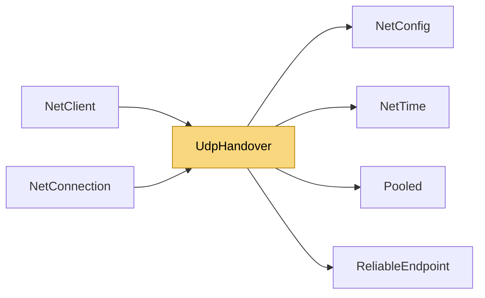

# UdpHandover

> [!info] Generated by `tools/generate-vault.py` from the source — do not edit by hand; rerun the script after code changes.

Moves a connection's UDP channels to TCP when UDP is lost mid-session, without losing, duplicating or reordering a message (feature `FeatureLiveDegrade`). The reliability layer keeps every unacknowledged packet and the receiver drops duplicates and restores order by sequence number, so the switch is: 1. stop admitting new messages on reliable UDP channels (they wait here); 2. point the reliability layer at TCP and resend everything unacknowledged; 3. once all of it is acknowledged — over TCP that means received and delivered in order — let the waiting and all later messages go as plain data over TCP. Both sides switch: the one that notices sends Degrade, the other follows on receipt, so acknowledgements travel over TCP too. A connection never switches back.

**Namespace** `NetSync.Peers` · **Folder** [[Module map Peers|Peers]] · **Layer** API

**Source** `src/NetSync/Peers/UdpHandover.cs`

## Types

| Type | Kind | Summary |
|---|---|---|
| `UdpHandover` | internal sealed class | Moves a connection's UDP channels to TCP when UDP is lost mid-session, without losing, duplicating or reordering a message (feature `FeatureLiveDegrade`). The reliability layer keeps every unacknowledged packet and… |

## Members

**UdpHandover**

- `public TransportType ReliableSlot`
- `public bool HasStarted`
- `public bool TryEnter()`
- `public void Exit()`
- `public ValueTask SendAfterSwitchAsync(ReadOnlyMemory<byte> data, Func<ReadOnlyMemory<byte>, ValueTask> send)`
- `public bool TryBegin()`
- `public void MoveReliableToTcp(ReliableEndpoint? reliable)`
- `public async Task<bool> FinishAsync(ReliableEndpoint? reliable, int timeoutMs, CancellationToken ct)`
- `public void Abort()`

## Depends on (4)

- **(root)**: [[NetConfig]] (`TransportType`)
- **Pipeline/Reliability**: [[ReliableEndpoint]]
- **Internal**: [[NetTime]], [[Pooled]]

## Used by (2)

- **Peers**: [[NetClient]], [[NetConnection]]

## Neighbourhood

