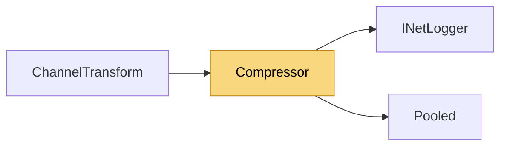

# Compressor

> [!info] Generated by `tools/generate-vault.py` from the source — do not edit by hand; rerun the script after code changes.

Deflate payload compression. Format: [originalLength:4 BE][deflate stream]. The explicit length lets the receiver allocate exactly once and enforce a decompression-bomb cap. Both directions work in pooled buffers; what still allocates is the Deflate stream itself (its native state) — compression is meant for bulk data.

**Namespace** `NetSync.Pipeline.Compression` · **Folder** [[Module map Pipeline Compression|Pipeline/Compression]] · **Layer** Session

**Source** `src/NetSync/Pipeline/Compression/Compressor.cs`

## Types

| Type | Kind | Summary |
|---|---|---|
| `Compressor` | internal static class | Deflate payload compression. Format: [originalLength:4 BE][deflate stream]. The explicit length lets the receiver allocate exactly once and enforce a decompression-bomb cap. Both directions work in pooled buffers;… |

## Members

**Compressor**

- `public static byte[]? TryCompress(ReadOnlySpan<byte> data, out int length)`
- `public static byte[]? Decompress(byte[] buffer, int offset, int count, int maxBytes, INetLogger logger, out int length)`

## Depends on (2)

- **Diagnostics**: [[INetLogger]]
- **Internal**: [[Pooled]]

## Used by (1)

- **Peers**: [[ChannelTransform]]

## Neighbourhood

