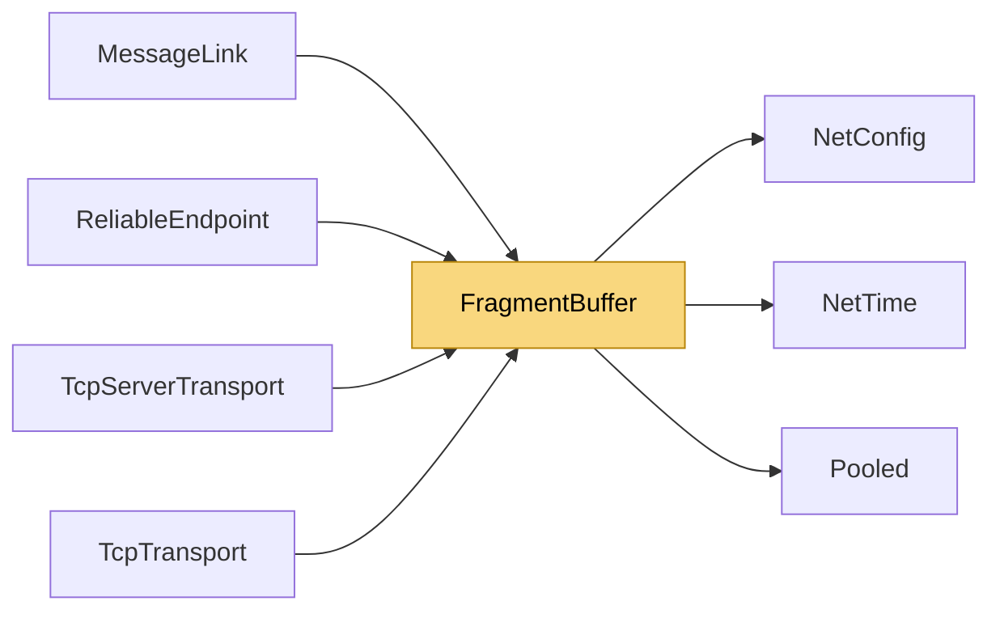

# FragmentBuffer

> [!info] Generated by `tools/generate-vault.py` from the source — do not edit by hand; rerun the script after code changes.

Reassembles fragmented packets with hard memory bounds — the remote decides fragment counts and sizes, so every number it sends is treated as hostile: per-packet byte cap, per-packet fragment cap, total buffered-bytes cap, concurrent-assembly cap, throttled stale cleanup. Fragments are held in pooled buffers and the reassembled message is handed out in a pooled buffer too (`TryAddFragmentPooled`): large transfers don't churn the large-object heap.

**Namespace** `NetSync.Pipeline.Fragmentation` · **Folder** [[Module map Pipeline Fragmentation|Pipeline/Fragmentation]] · **Layer** Infrastructure

**Source** `src/NetSync/Pipeline/Fragmentation/FragmentBuffer.cs`

## Types

| Type | Kind | Summary |
|---|---|---|
| `FragmentBuffer` | public sealed class | Reassembles fragmented packets with hard memory bounds — the remote decides fragment counts and sizes, so every number it sends is treated as hostile: per-packet byte cap, per-packet fragment cap, total… |
| ↳ `Assembly` | private sealed class |  |

## Members

**FragmentBuffer**

- `public int FragmentTimeoutMs`
- `public int MaxConcurrentPackets`
- `public int MaxFragmentsPerPacket`
- `public long MaxPacketBytes`
- `public long MaxBufferedBytes`
- `public byte[]? AddFragment(uint sequenceId, uint index, uint total, byte[] data)`
- `public bool TryAddFragment(uint sequenceId, uint index, uint total, byte[] data, out byte[]? complete)`
- `internal bool TryAddFragmentPooled(uint sequenceId, uint index, uint total, ReadOnlySpan<byte> data,`
- `public int ActiveCount`
- `public long BufferedBytes`
- `public void Clear()`

## Depends on (3)

- **(root)**: [[NetConfig]]
- **Internal**: [[NetTime]], [[Pooled]]

## Used by (4)

- **Pipeline/Reliability**: [[ReliableEndpoint]]
- **Transports**: [[MessageLink]]
- **Transports/Tcp**: [[TcpServerTransport]], [[TcpTransport]]

## Neighbourhood

