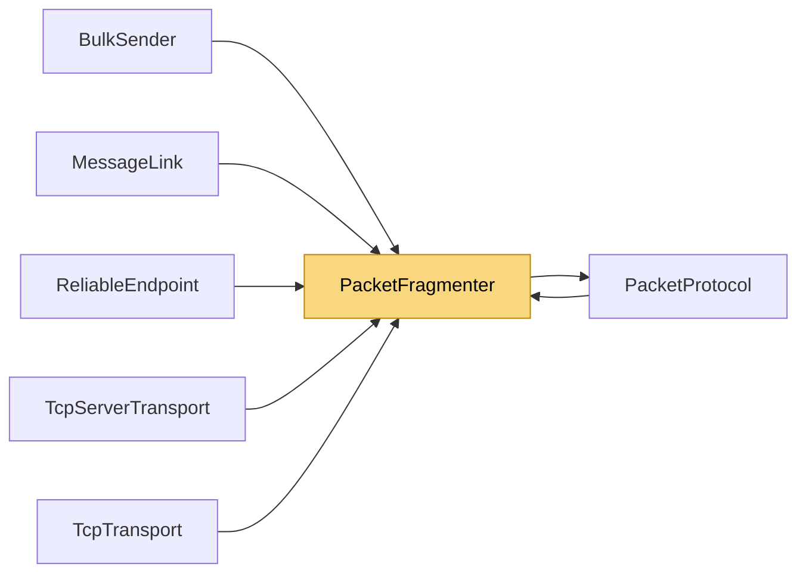

# PacketFragmenter

> [!info] Generated by `tools/generate-vault.py` from the source — do not edit by hand; rerun the script after code changes.

Splits large payloads into fragments and back. Fragment wire format: [Fragment:1][seqId:4 BE][index:4 BE][total:4 BE][data]

**Namespace** `NetSync.Pipeline.Fragmentation` · **Folder** [[Module map Pipeline Fragmentation|Pipeline/Fragmentation]] · **Layer** Infrastructure

**Source** `src/NetSync/Pipeline/Fragmentation/PacketFragmenter.cs`

## Types

| Type | Kind | Summary |
|---|---|---|
| `PacketFragmenter` | public static class | Splits large payloads into fragments and back. Fragment wire format: [Fragment:1][seqId:4 BE][index:4 BE][total:4 BE][data] |

## Members

**PacketFragmenter**

- `public const int FragmentSizeUdp = 1200`
- `public const int FragmentSizeTcp = 16 * 1024`
- `public const int MaxUnfragmentedSize = 64 * 1024`
- `public const int HeaderSize = 13`
- `public static uint NextSequenceId()`
- `public static byte[][] Fragment(ReadOnlySpan<byte> data, uint sequenceId, int fragmentSize)`
- `public static void WriteFragmentHeader(Span<byte> dest, uint sequenceId, uint index, uint total)`
- `public static bool TryUnwrap(ReadOnlySpan<byte> packet, out uint sequenceId, out uint index, out uint total, out byte[] data)`
- `internal static bool TryParse(ReadOnlySpan<byte> packet, out uint sequenceId, out uint index, out uint total, out ReadOnlySpan<byte> chunk)`

## Depends on (1)

- **Transports**: [[PacketProtocol]] (`PacketType`)

## Used by (6)

- **Pipeline/Reliability**: [[ReliableEndpoint]]
- **Transports**: [[BulkSender]], [[MessageLink]], [[PacketProtocol]]
- **Transports/Tcp**: [[TcpServerTransport]], [[TcpTransport]]

## Neighbourhood

