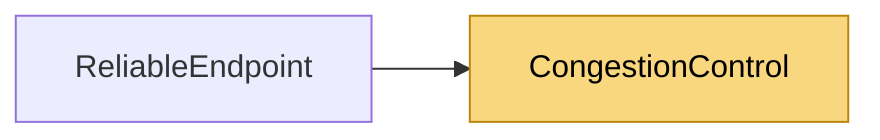

# CongestionControl

> [!info] Generated by `tools/generate-vault.py` from the source — do not edit by hand; rerun the script after code changes.

Link round-trip estimator from ACK samples (RFC 6298: SRTT/RTTVAR, Karn's rule is applied by the caller — only first transmissions are sampled). Also tracks a windowed minimum RTT, the "empty queue" baseline for delay-based control. Not thread-safe; owned by the endpoint under its RTT lock.

**Namespace** `NetSync.Pipeline.Reliability` · **Folder** [[Module map Pipeline Reliability|Pipeline/Reliability]] · **Layer** Session

**Source** `src/NetSync/Pipeline/Reliability/CongestionControl.cs`

## Types

| Type | Kind | Summary |
|---|---|---|
| `RttEstimator` | internal sealed class | Link round-trip estimator from ACK samples (RFC 6298: SRTT/RTTVAR, Karn's rule is applied by the caller — only first transmissions are sampled). Also tracks a windowed minimum RTT, the "empty queue" baseline for… |
| `CongestionWindow` | internal sealed class | Per-channel congestion window, in packets in flight. Loss-based (Normal/High): Reno-style — slow start to ssthresh, then +1 packet per RTT; a loss event halves the window at most once per RTT. Delay-based (Low):… |

## Members

**RttEstimator**

- `public bool HasSample`
- `public double SmoothedRtt`
- `public double BaseRtt`
- `public double QueueingDelay`
- `public void AddSample(double rttMs, long nowMs)`
- `public int RetransmitTimeoutMs(int floorMs, int ceilingMs, int fallbackMs)`

**CongestionWindow**

- `public const double InitialWindow = 16`
- `public const double MinWindow = 2`
- `public const double TargetQueueingDelayMs = 25`
- `public double Window`
- `public CongestionWindow(bool background, double maxWindow)`
- `public int AllowedInFlight`
- `public void OnAcked(int newlyAcked, RttEstimator rtt, long nowMs)`
- `public void OnLoss(RttEstimator rtt, long nowMs)`

## Depends on (0)

—

## Used by (1)

- **Pipeline/Reliability**: [[ReliableEndpoint]] (`CongestionWindow`, `RttEstimator`)

## Neighbourhood

