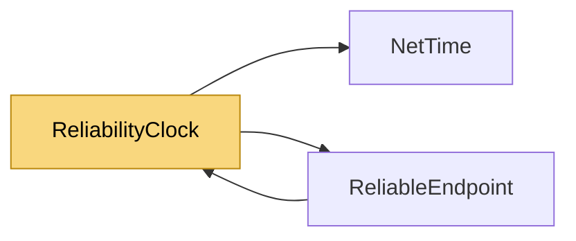

# ReliabilityClock

> [!info] Generated by `tools/generate-vault.py` from the source — do not edit by hand; rerun the script after code changes.

One thread drives the retransmission timers of every `ReliableEndpoint` in the process. A loop per endpoint would mean a timer wake-up per connection every few milliseconds — 100 000+ wake-ups a second on a server with a thousand clients; one clock scanning them all costs a few microseconds per idle connection per tick. Sleeps entirely while no endpoint exists.

**Namespace** `NetSync.Pipeline.Reliability` · **Folder** [[Module map Pipeline Reliability|Pipeline/Reliability]] · **Layer** Session

**Source** `src/NetSync/Pipeline/Reliability/ReliabilityClock.cs`

## Types

| Type | Kind | Summary |
|---|---|---|
| `ReliabilityClock` | internal static class | One thread drives the retransmission timers of every `ReliableEndpoint` in the process. A loop per endpoint would mean a timer wake-up per connection every few milliseconds — 100 000+ wake-ups a second on a server… |

## Members

**ReliabilityClock**

- `public static void Register(ReliableEndpoint endpoint)`
- `public static void Unregister(ReliableEndpoint endpoint)`
- `public static int Count`

## Depends on (2)

- **Pipeline/Reliability**: [[ReliableEndpoint]]
- **Internal**: [[NetTime]]

## Used by (1)

- **Pipeline/Reliability**: [[ReliableEndpoint]]

## Neighbourhood

