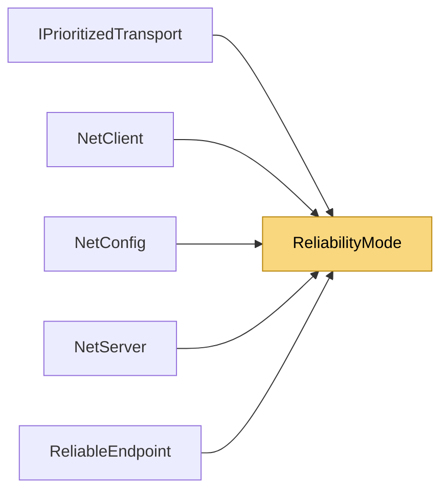

# ReliabilityMode

> [!NOTE]
> Generated by `tools/generate-vault.py` from the source — do not edit by hand; rerun the script after code changes.

Delivery guarantees for a channel. Only meaningful on UDP: TCP channels are inherently reliable-ordered and ignore this setting.

**Namespace** `NetSync` · **Folder** [Pipeline/Reliability](../../../4%20Diagrams/Modules/Module%20map%20Pipeline%20Reliability.md) · **Layer** Session

**Source** `src/NetSync/Pipeline/Reliability/ReliabilityMode.cs`

## Types

| Type | Kind | Summary |
|---|---|---|
| `ReliabilityMode` | public enum | Delivery guarantees for a channel. Only meaningful on UDP: TCP channels are inherently reliable-ordered and ignore this setting. |
| `ChannelPriority` | public enum | How a channel shares the link with other channels. |

## Depends on (0)

—

## Used by (5)

- **(root)**: [NetConfig](../../Root/NetConfig.md) (`ChannelPriority`, `ReliabilityMode`)
- **Peers**: [NetClient](../../Peers/NetClient.md), [NetServer](../../Peers/NetServer.md)
- **Pipeline/Reliability**: [ReliableEndpoint](ReliableEndpoint.md) (`ChannelPriority`, `ReliabilityMode`)
- **Transports**: [IPrioritizedTransport](../../Transports/IPrioritizedTransport.md) (`ChannelPriority`)

## Neighbourhood

