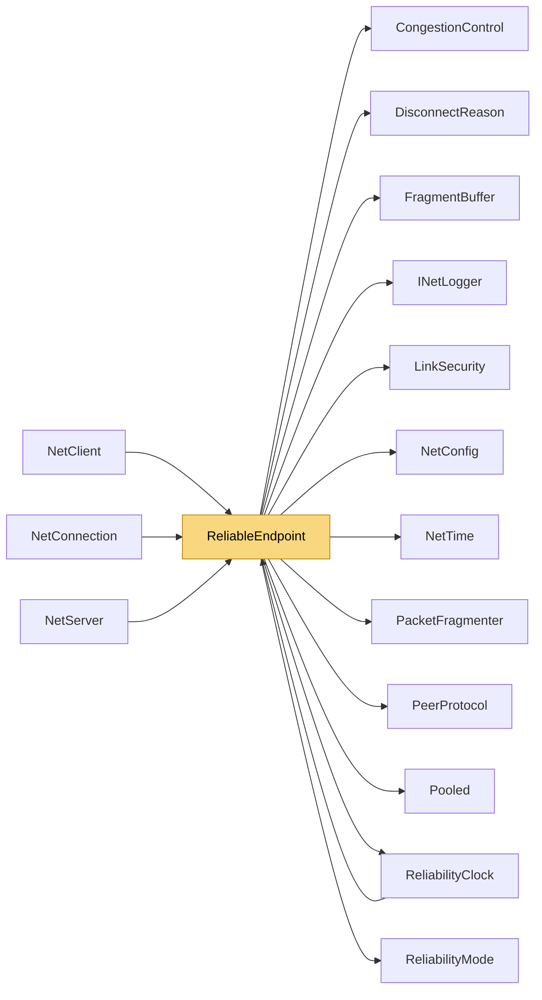

# ReliableEndpoint

> [!info] Generated by `tools/generate-vault.py` from the source — do not edit by hand; rerun the script after code changes.

Reliability engine for one unreliable datagram link (ENet-style ARQ with TCP-grade congestion control). One instance per datagram link; transport-agnostic — it only needs a send delegate. Per channel, depending on `ReliabilityMode`: - 16-bit wrap-aware sequence numbers and a 256-packet range window, - ACKs carrying a 32-packet history bitmask: immediate, or — on links that report datagram boundaries (`DeferAcks`) — one per channel per received datagram, sent together with the replies to it, - RTO from ACK-sampled SRTT/RTTVAR (Karn's rule), exponential backoff, - fast retransmit after 3 later packets were acked (loss recovered in ~1 RTT), - congestion window per channel: Reno-style, or delay-based scavenger for `Low` channels, - duplicate elimination and (ReliableOrdered) reorder buffering, - fragmentation above `FragmentSize` (1100 B, raised to fit the path MTU once measured), reliable or unreliable. Threading: HandleRelData/HandleAck are called from the link's receive thread; Send* may be called from any thread; retransmission timers run on the shared `ReliabilityClock` thread (`Tick`). Sender state is guarded by a per-channel lock (then the RTT lock — always in that order); receiver state is only touched by the receive thread. Memory: every packet lives in a pooled buffer. A pending packet's buffer can be read by a (re)transmission outside the lock while an ACK removes it, so it goes back to the pool only when no send is reading it (PendingPacket.InFlight). The send delegate must consume the bytes before it returns (all NetSync links do). Delivered payloads are valid only during the deliver callback.

**Namespace** `NetSync.Pipeline.Reliability` · **Folder** [[Module map Pipeline Reliability|Pipeline/Reliability]] · **Layer** Session

**Source** `src/NetSync/Pipeline/Reliability/ReliableEndpoint.cs`

## Types

| Type | Kind | Summary |
|---|---|---|
| `ReliableEndpoint` | internal sealed class | Reliability engine for one unreliable datagram link (ENet-style ARQ with TCP-grade congestion control). One instance per datagram link; transport-agnostic — it only needs a send delegate. Per channel, depending on… |
| ↳ `SegmentHandler` | public delegate | Receives a payload; buffer[offset..offset+count) is valid only during the call. |
| ↳ `PendingPacket` | private sealed class |  |
| ↳ `SenderState` | private sealed class |  |
| ↳ `HeldPacket` | private struct |  |
| ↳ `ReceiverState` | private sealed class |  |
| ↳ `FragmentInfo` | private struct |  |

## Extends / implements

- `ReliableEndpoint` → `IDisposable`

## Members

**ReliableEndpoint**

- `public const int WindowSize = 256`
- `public const int FragmentThreshold = 1100`
- `public const int MaxFragmentSize = 1472 - 1 - RelDataHeaderSize - PacketFragmenter.HeaderSize`
- `public static int FragmentSizeForDatagram(int datagramSize, bool enveloped)`
- `public int FragmentSize`
- `public const int RelDataHeaderSize = 5`
- `public const int RelAckSize = 8`
- `public ReliableEndpoint(`
- `public ReliableEndpoint(`
- `public bool DeferAcks`
- `public void Start()`
- `public long PacketsSent`
- `public long Retransmissions`
- `public long FastRetransmissions`
- `public double SmoothedRttMs`
- `public double GetCongestionWindow(byte channel)`
- `public ValueTask SendAsync(byte channel, ReadOnlyMemory<byte> data, CancellationToken ct = default)`
- `public ValueTask SendReliableAsync(byte channel, ReadOnlyMemory<byte> data, CancellationToken ct = default)`
- `public ValueTask SendSequencedAsync(byte channel, ReadOnlyMemory<byte> data)`
- `public ValueTask SendUnreliableFragmentedAsync(byte channel, ReadOnlyMemory<byte> data)`
- `public void HandleRelData(byte[] buffer, int offset, int count)`
- `public void FlushAcks()`
- `public void HandleAck(byte[] buffer, int offset, int count)`
- `internal void Tick(long now)`
- `public void Dispose()`

## Depends on (12)

- **(root)**: [[NetConfig]] (`ChannelConfig`, `NetConfig`, `TransportType`)
- **Peers**: [[PeerProtocol]]
- **Pipeline/Reliability**: [[CongestionControl]] (`CongestionWindow`, `RttEstimator`), [[ReliabilityClock]], [[ReliabilityMode]] (`ChannelPriority`, `ReliabilityMode`)
- **Pipeline/Security**: [[LinkSecurity]]
- **Transports**: [[DisconnectReason]]
- **Pipeline/Fragmentation**: [[FragmentBuffer]], [[PacketFragmenter]]
- **Diagnostics**: [[INetLogger]]
- **Internal**: [[NetTime]], [[Pooled]]

## Used by (4)

- **Peers**: [[NetClient]], [[NetConnection]], [[NetServer]]
- **Pipeline/Reliability**: [[ReliabilityClock]]

## Neighbourhood

