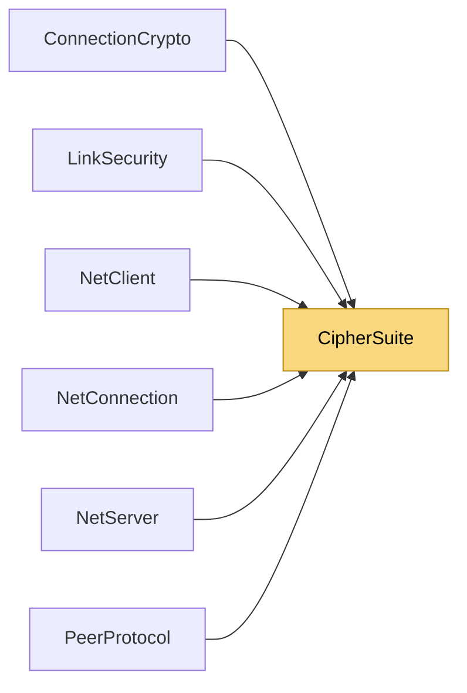

# CipherSuite

> [!info] Generated by `tools/generate-vault.py` from the source — do not edit by hand; rerun the script after code changes.

How an encrypted connection protects packets. Negotiated in the handshake: the client offers what its runtime supports, the server picks the best common suite.

**Namespace** `NetSync` · **Folder** [[Module map Pipeline Security|Pipeline/Security]] · **Layer** Session

**Source** `src/NetSync/Pipeline/Security/CipherSuite.cs`

## Types

| Type | Kind | Summary |
|---|---|---|
| `CipherSuite` | public enum | How an encrypted connection protects packets. Negotiated in the handshake: the client offers what its runtime supports, the server picks the best common suite. |
| `CipherSuites` | internal static class |  |

## Members

**CipherSuites**

- `public const byte MaskCbc = 1 << 0`
- `public const byte MaskGcm = 1 << 1`
- `public static bool GcmSupported`
- `public static byte LocalMask`
- `public static CipherSuite Choose(byte offered)`
- `public static bool IsOffered(byte offered, CipherSuite suite)`

## Depends on (0)

—

## Used by (6)

- **Peers**: [[NetClient]] (`CipherSuite`, `CipherSuites`), [[NetConnection]], [[NetServer]] (`CipherSuite`, `CipherSuites`), [[PeerProtocol]]
- **Pipeline/Security**: [[ConnectionCrypto]], [[LinkSecurity]]

## Neighbourhood

