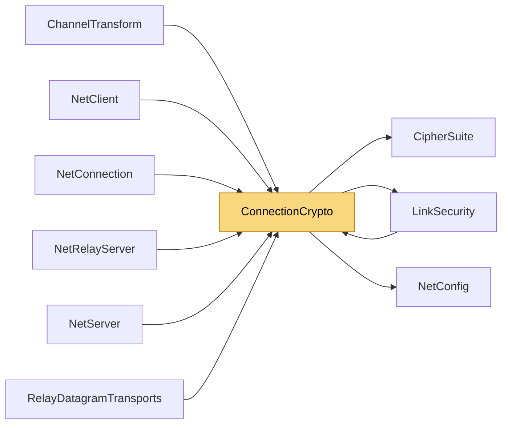

# ConnectionCrypto

> [!info] Generated by `tools/generate-vault.py` from the source — do not edit by hand; rerun the script after code changes.

Per-connection key material and the payload cipher, for one side (client or server) of one connection. Every key is per direction (client→server, server→client): a peer never encrypts or authenticates with the key it verifies with, so its own packets can't be reflected back to it, and GCM nonces can't collide between directions. Payload encryption only provides confidentiality on top of an already authenticated packet: every post-handshake packet travels in a `LinkSecurity` envelope whose tag covers the ciphertext. Hence: - AesCbcHmacSha256: [iv:16][ciphertext] — no second MAC (the envelope's HMAC is it). - AesGcm: [nonce:12][tag:16][ciphertext] — GCM's own tag comes for free. Both are allocation-free on net8.0; netstandard2.1 runs CBC through the classic transform API, which allocates per message.

**Namespace** `NetSync.Pipeline.Security` · **Folder** [[Module map Pipeline Security|Pipeline/Security]] · **Layer** Session

**Source** `src/NetSync/Pipeline/Security/ConnectionCrypto.cs`

## Types

| Type | Kind | Summary |
|---|---|---|
| `ConnectionCrypto` | internal sealed class | Per-connection key material and the payload cipher, for one side (client or server) of one connection. Every key is per direction (client→server, server→client): a peer never encrypts or authenticates with the key it… |

## Extends / implements

- `ConnectionCrypto` → `IDisposable`

## Members

**ConnectionCrypto**

- `public CipherSuite Suite`
- `public int MaxOverhead`
- `public static ConnectionCrypto FromSecret(byte[] sessionSecret, CipherSuite suite, bool isClient)`
- `public static ConnectionCrypto FromPresharedKey(byte[] presharedKey, long sessionToken, CipherSuite suite, bool isClient)`
- `public LinkSecurity CreateLinkSecurity(TransportType slot)`
- `public int Encrypt(ReadOnlySpan<byte> plaintext, Span<byte> destination)`
- `public int Decrypt(ReadOnlySpan<byte> message, Span<byte> destination)`
- `internal static bool FixedTimeEquals(ReadOnlySpan<byte> a, ReadOnlySpan<byte> b)`
- `public void Dispose()`

## Depends on (3)

- **(root)**: [[NetConfig]] (`TransportType`)
- **Pipeline/Security**: [[CipherSuite]], [[LinkSecurity]]

## Used by (7)

- **Peers**: [[ChannelTransform]], [[NetClient]], [[NetConnection]], [[NetServer]]
- **Pipeline/Security**: [[LinkSecurity]]
- **Relay**: [[NetRelayServer]], [[RelayDatagramTransports]]

## Neighbourhood

