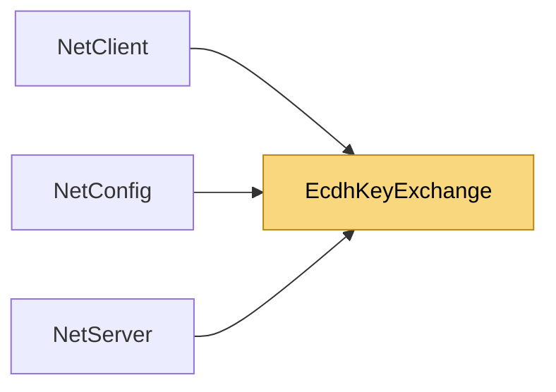

# EcdhKeyExchange

> [!info] Generated by `tools/generate-vault.py` from the source — do not edit by hand; rerun the script after code changes.

Ephemeral ECDH (NIST P-256) helpers. Public keys travel as raw 64-byte X‖Y points — no ASN.1, works on both target frameworks. The exchange is unauthenticated: it defeats passive eavesdropping, not an active MITM (documented in `Ecdh`).

**Namespace** `NetSync.Pipeline.Security` · **Folder** [[Module map Pipeline Security|Pipeline/Security]] · **Layer** Session

**Source** `src/NetSync/Pipeline/Security/EcdhKeyExchange.cs`

## Types

| Type | Kind | Summary |
|---|---|---|
| `EcdhKeyExchange` | internal static class | Ephemeral ECDH (NIST P-256) helpers. Public keys travel as raw 64-byte X‖Y points — no ASN.1, works on both target frameworks. The exchange is unauthenticated: it defeats passive eavesdropping, not an active MITM… |

## Members

**EcdhKeyExchange**

- `public const int PublicKeySize = 64`
- `public static bool IsSupported`
- `public static ECDiffieHellman Create()`
- `public static byte[] ExportPublicKey(ECDiffieHellman ecdh)`
- `public static byte[] DeriveSessionSecret(ECDiffieHellman mine, ReadOnlySpan<byte> theirPublicKey, long sessionToken)`

## Depends on (0)

—

## Used by (3)

- **(root)**: [[NetConfig]]
- **Peers**: [[NetClient]], [[NetServer]]

## Neighbourhood

