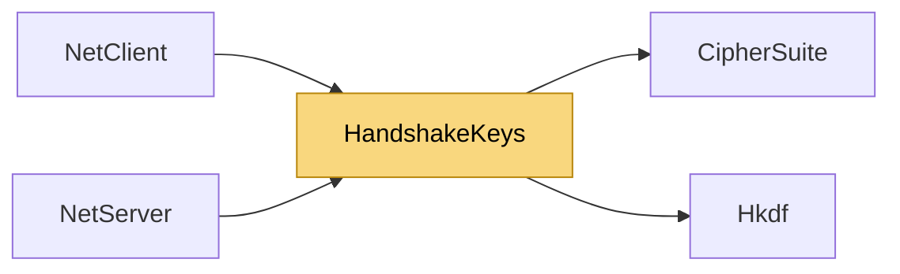

# HandshakeKeys

> [!info] Generated by `tools/generate-vault.py` from the source — do not edit by hand; rerun the script after code changes.

Session keys of protocol v4. Every keyed connection runs an ephemeral X25519 exchange, so both sides contribute fresh randomness to every session; what authenticates it is mixed into the same derivation: - PresharedKey: the shared key — only holders of it arrive at the same session keys; - a server identity: a second exchange between the client's ephemeral key and the server's long-term key — only the holder of that private key arrives at them. secret = HKDF-SHA256(salt = SHA-256(transcript), ikm = ee ‖ [es] ‖ [psk], info = "NetSync/4 session") The transcript covers every negotiated value, so none of them can be altered in transit without the two sides ending up with different keys.

**Namespace** `NetSync.Pipeline.Security` · **Folder** [[Module map Pipeline Security|Pipeline/Security]] · **Layer** Session

**Source** `src/NetSync/Pipeline/Security/HandshakeKeys.cs`

## Types

| Type | Kind | Summary |
|---|---|---|
| `HandshakeKeys` | internal static class | Session keys of protocol v4. Every keyed connection runs an ephemeral X25519 exchange, so both sides contribute fresh randomness to every session; what authenticates it is mixed into the same derivation: -… |

## Members

**HandshakeKeys**

- `public const int SecretSize = 32`
- `public static byte[] Transcript(long token, uint configHash, byte keyExchange, byte offeredSuites, ulong appId, ushort appVersion,`
- `public static byte[] SessionSecret(ReadOnlySpan<byte> transcript, ReadOnlySpan<byte> ephemeralShared,`

## Depends on (2)

- **Pipeline/Security**: [[CipherSuite]], [[Hkdf]]

## Used by (2)

- **Peers**: [[NetClient]], [[NetServer]]

## Neighbourhood

