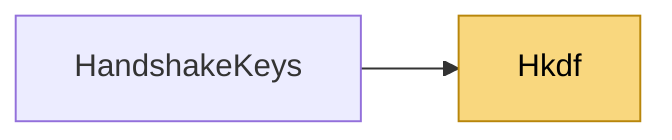

# Hkdf

> [!info] Generated by `tools/generate-vault.py` from the source — do not edit by hand; rerun the script after code changes.

HKDF with HMAC-SHA256 (RFC 5869). The class library has one only on newer targets; this is the same function everywhere.

**Namespace** `NetSync.Pipeline.Security` · **Folder** [[Module map Pipeline Security|Pipeline/Security]] · **Layer** Session

**Source** `src/NetSync/Pipeline/Security/Hkdf.cs`

## Types

| Type | Kind | Summary |
|---|---|---|
| `Hkdf` | internal static class | HKDF with HMAC-SHA256 (RFC 5869). The class library has one only on newer targets; this is the same function everywhere. |

## Members

**Hkdf**

- `public const int HashSize = 32`
- `public static byte[] Extract(ReadOnlySpan<byte> salt, ReadOnlySpan<byte> inputKeyMaterial)`
- `public static byte[] Expand(byte[] pseudorandomKey, ReadOnlySpan<byte> info, int length)`
- `public static byte[] DeriveKey(ReadOnlySpan<byte> inputKeyMaterial, ReadOnlySpan<byte> salt, ReadOnlySpan<byte> info, int length)`

## Depends on (0)

—

## Used by (1)

- **Pipeline/Security**: [[HandshakeKeys]]

## Neighbourhood

