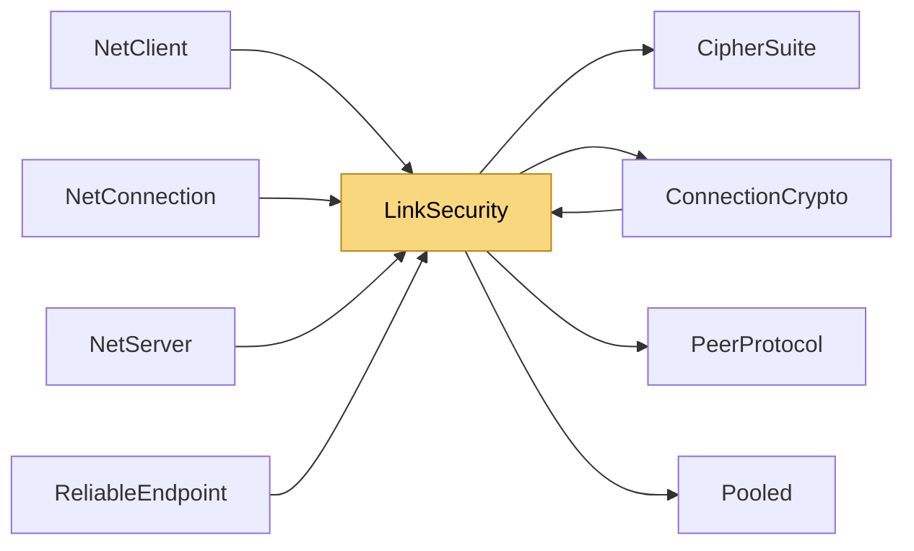

# LinkSecurity

> [!info] Generated by `tools/generate-vault.py` from the source — do not edit by hand; rerun the script after code changes.

Authenticates every post-handshake packet on one link of an encrypted connection. Envelope: [MsgSecure:1][counter:8 BE][tag:16][inner peer message…] - AesCbcHmacSha256: tag = HMAC-SHA256(directionKey, slot ‖ counter ‖ inner)[0..16] - AesGcm: tag = GMAC(directionKey, nonce = slot ‖ 0 0 0 ‖ counter, aad = inner) This closes what payload encryption alone leaves open: the inner message's header — channel, flags, sequence number, and whole ACK/Bye/Degrade messages — is covered by the tag, so it can't be forged (e.g. fake ACKs that make a "reliable" channel lose data) or moved between links/channels. The 64-bit counter plus a 1024-packet sliding window rejects replays, while still accepting the reordering UDP produces. Confidentiality stays per channel (Encryption flag). Thread-safety: Wrap may be called from any thread (counter and MAC under a lock); Unwrap is called only from the link's receive thread. Allocation-free: incremental MACs into stack buffers, envelopes in pooled buffers.

**Namespace** `NetSync.Pipeline.Security` · **Folder** [[Module map Pipeline Security|Pipeline/Security]] · **Layer** Session

**Source** `src/NetSync/Pipeline/Security/LinkSecurity.cs`

## Types

| Type | Kind | Summary |
|---|---|---|
| `LinkSecurity` | internal sealed class | Authenticates every post-handshake packet on one link of an encrypted connection. Envelope: [MsgSecure:1][counter:8 BE][tag:16][inner peer message…] - AesCbcHmacSha256: tag = HMAC-SHA256(directionKey, slot ‖ counter… |
| ↳ `UnwrapResult` | public enum |  |

## Extends / implements

- `LinkSecurity` → `IDisposable`

## Members

**LinkSecurity**

- `public const int TagSize = 16`
- `public const int HeaderSize = 1 + 8 + TagSize`
- `public const int ReplayWindowSize = 1024`
- `public LinkSecurity(byte slot, CipherSuite suite, byte[] sendKey, byte[] receiveKey)`
- `public byte[] Wrap(ReadOnlySpan<byte> prefix, ReadOnlySpan<byte> payload)`
- `public byte[] WrapPooled(ReadOnlySpan<byte> prefix, ReadOnlySpan<byte> payload, out int length)`
- `public bool TryUnwrap(byte[] buffer, int offset, int count, out int innerOffset, out int innerCount)`
- `public UnwrapResult Unwrap(byte[] buffer, int offset, int count, out int innerOffset, out int innerCount)`
- `public void Dispose()`

## Depends on (4)

- **Peers**: [[PeerProtocol]]
- **Pipeline/Security**: [[CipherSuite]], [[ConnectionCrypto]]
- **Internal**: [[Pooled]]

## Used by (5)

- **Peers**: [[NetClient]], [[NetConnection]], [[NetServer]]
- **Pipeline/Reliability**: [[ReliableEndpoint]]
- **Pipeline/Security**: [[ConnectionCrypto]]

## Neighbourhood

