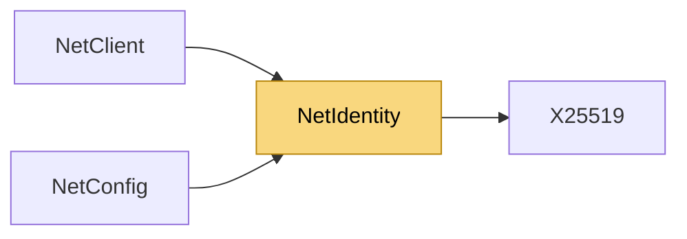

# NetIdentity

> [!info] Generated by `tools/generate-vault.py` from the source — do not edit by hand; rerun the script after code changes.

A server's long-term identity: an X25519 key pair. Every handshake mixes an exchange with this key into the session keys, so only the holder of the private key can complete it; clients that pin the public key (`TrustedServerKeys`) refuse anyone else — this is what makes `Ecdh` safe against an active man-in-the-middle, the way a pinned certificate does for TLS. Generate once, store the private key (`ExportPrivateKey`) like any secret, ship the public key (or its `Fingerprint`) with your clients. Works on every runtime: the implementation is part of the library.

**Namespace** `NetSync` · **Folder** [[Module map Pipeline Security|Pipeline/Security]] · **Layer** Session

**Source** `src/NetSync/Pipeline/Security/NetIdentity.cs`

## Types

| Type | Kind | Summary |
|---|---|---|
| `NetIdentity` | public sealed class | A server's long-term identity: an X25519 key pair. Every handshake mixes an exchange with this key into the session keys, so only the holder of the private key can complete it; clients that pin the public key… |

## Extends / implements

- `NetIdentity` → `IDisposable`

## Members

**NetIdentity**

- `public const int PublicKeySize = X25519.KeySize`
- `public const int PrivateKeySize = X25519.KeySize`
- `public byte[] PublicKey`
- `public string Fingerprint`
- `public static bool IsSupported`
- `public static NetIdentity Generate()`
- `public static NetIdentity FromPrivateKey(byte[] privateKey)`
- `public byte[] ExportPrivateKey()`
- `public static string GetFingerprint(byte[] publicKey)`
- `internal bool TrySharedSecret(ReadOnlySpan<byte> clientPublicKey, Span<byte> sharedSecret)`
- `public void Dispose()`

## Depends on (1)

- **Pipeline/Security**: [[X25519]]

## Used by (2)

- **(root)**: [[NetConfig]]
- **Peers**: [[NetClient]]

## Neighbourhood

