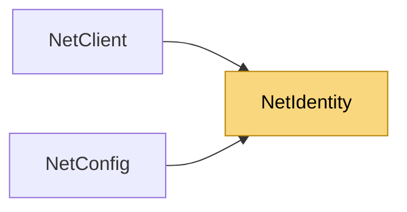

# NetIdentity

> [!info] Generated by `tools/generate-vault.py` from the source — do not edit by hand; rerun the script after code changes.

A server's long-term identity: an ECDSA P-256 key pair. The server signs every ECDH handshake with it; clients that pin the public key (`TrustedServerKeys`) refuse anyone else — this is what makes `Ecdh` safe against an active man-in-the-middle, the way a pinned certificate does for TLS. Generate once, store the private key (`ExportPrivateKey`) like any secret, ship the public key (or its `Fingerprint`) with your clients.

**Namespace** `NetSync` · **Folder** [[Module map Pipeline Security|Pipeline/Security]] · **Layer** Session

**Source** `src/NetSync/Pipeline/Security/NetIdentity.cs`

## Types

| Type | Kind | Summary |
|---|---|---|
| `NetIdentity` | public sealed class | A server's long-term identity: an ECDSA P-256 key pair. The server signs every ECDH handshake with it; clients that pin the public key (`TrustedServerKeys`) refuse anyone else — this is what makes `Ecdh` safe against… |

## Extends / implements

- `NetIdentity` → `IDisposable`

## Members

**NetIdentity**

- `public const int PublicKeySize = 64`
- `public const int PrivateKeySize = 96`
- `internal const int SignatureSize = 64`
- `public byte[] PublicKey`
- `public string Fingerprint`
- `public static bool IsSupported`
- `public static NetIdentity Generate()`
- `public static NetIdentity FromPrivateKey(byte[] privateKey)`
- `public byte[] ExportPrivateKey()`
- `public static string GetFingerprint(byte[] publicKey)`
- `internal byte[] Sign(byte[] data)`
- `internal static bool Verify(byte[] publicKey, byte[] data, byte[] signature)`
- `public void Dispose()`

## Depends on (0)

—

## Used by (2)

- **(root)**: [[NetConfig]]
- **Peers**: [[NetClient]]

## Neighbourhood

