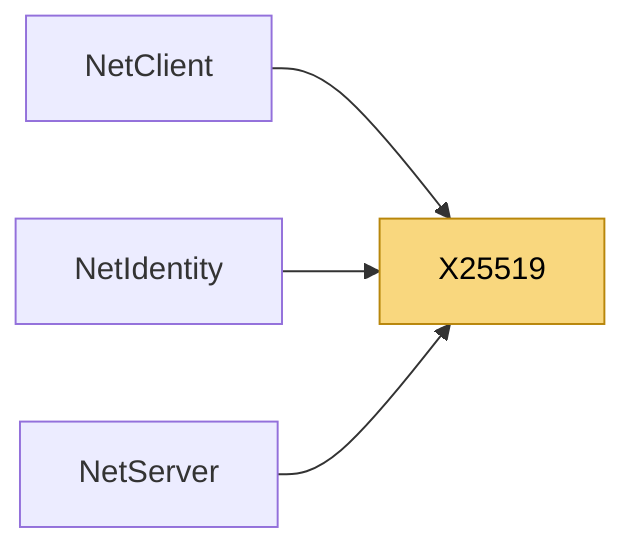

# X25519

> [!info] Generated by `tools/generate-vault.py` from the source — do not edit by hand; rerun the script after code changes.

**Namespace** `NetSync.Pipeline.Security` · **Folder** [[Module map Pipeline Security|Pipeline/Security]] · **Layer** Session

**Source** `src/NetSync/Pipeline/Security/X25519.Fast.cs` · `src/NetSync/Pipeline/Security/X25519.cs`

## Types

| Type | Kind | Summary |
|---|---|---|
| `X25519` | internal static class |  |
| ↳ `Fe` | private struct |  |

## Members

**X25519**

- `public const int KeySize = 32`
- `public static void GeneratePrivateKey(Span<byte> privateKey)`
- `public static void PublicKey(ReadOnlySpan<byte> privateKey, Span<byte> publicKey)`
- `public static bool TrySharedSecret(ReadOnlySpan<byte> privateKey, ReadOnlySpan<byte> theirPublicKey, Span<byte> sharedSecret)`
- `public static void ScalarMultiply(ReadOnlySpan<byte> scalar, ReadOnlySpan<byte> point, Span<byte> result)`
- `internal static void ScalarMultiplyPortable(ReadOnlySpan<byte> scalar, ReadOnlySpan<byte> point, Span<byte> result)`

## Depends on (0)

—

## Used by (3)

- **Peers**: [[NetClient]], [[NetServer]]
- **Pipeline/Security**: [[NetIdentity]]

## Neighbourhood

