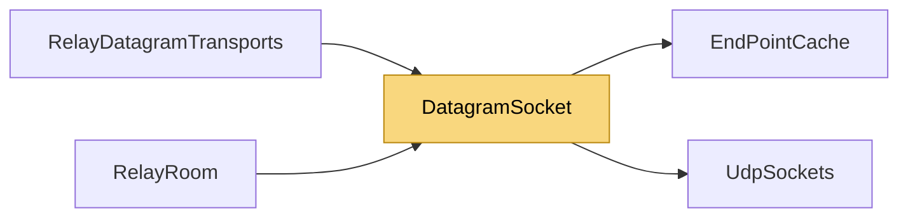

# DatagramSocket

> [!info] Generated by `tools/generate-vault.py` from the source — do not edit by hand; rerun the script after code changes.

A plain unconnected UDP socket on an ephemeral port. On net8.0 sends and receives cost no allocation (cached addresses: a relay socket talks to a handful of peers).

**Namespace** `NetSync.Relay` · **Folder** [[Module map Relay|Relay]] · **Layer** Transports

**Source** `src/NetSync/Relay/DatagramSocket.cs`

## Types

| Type | Kind | Summary |
|---|---|---|
| `IDatagramSocket` | internal interface | The UDP socket of a relay transport, as an interface: hole punching depends on how the network maps and filters datagrams, and tests substitute NAT behaviours here. |
| `DatagramSocket` | internal sealed class | A plain unconnected UDP socket on an ephemeral port. On net8.0 sends and receives cost no allocation (cached addresses: a relay socket talks to a handful of peers). |

## Extends / implements

- `IDatagramSocket` → `IDisposable`
- `DatagramSocket` → `IDatagramSocket`

## Members

**DatagramSocket**

- `public DatagramSocket(AddressFamily family)`
- `public IPEndPoint LocalEndPoint`
- `public void SendTo(byte[] buffer, int offset, int count, IPEndPoint remote)`
- `public int ReceiveFrom(byte[] buffer, out IPEndPoint remote)`
- `public void Dispose()`

## Depends on (2)

- **Transports/Udp**: [[EndPointCache]] (`EndPointCache`, `SocketAddressCache`), [[UdpSockets]]

## Used by (2)

- **Relay**: [[RelayDatagramTransports]] (`IDatagramSocket`), [[RelayRoom]] (`DatagramSocket`, `IDatagramSocket`)

## Neighbourhood

