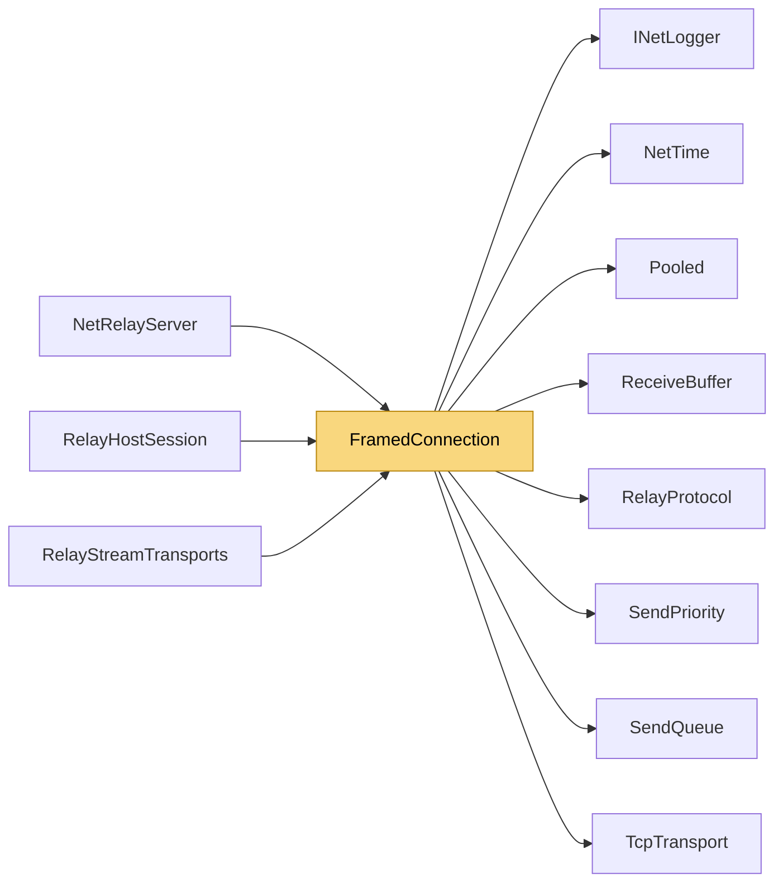

# FramedConnection

> [!info] Generated by `tools/generate-vault.py` from the source — do not edit by hand; rerun the script after code changes.

A TCP connection carrying relay frames ([kind][length][body]) in both directions: coalescing priority send queue, one pooled receive buffer, bounded frame size, write watchdog. Used by the relay server, relay hosts and relay clients alike.

**Namespace** `NetSync.Relay` · **Folder** [[Module map Relay|Relay]] · **Layer** Transports

**Source** `src/NetSync/Relay/FramedConnection.cs`

## Types

| Type | Kind | Summary |
|---|---|---|
| `FramedConnection` | internal sealed class | A TCP connection carrying relay frames ([kind][length][body]) in both directions: coalescing priority send queue, one pooled receive buffer, bounded frame size, write watchdog. Used by the relay server, relay hosts… |
| ↳ `FrameHandler` | public delegate | Handles one frame; buffer valid only during the call. False = protocol violation. |

## Extends / implements

- `FramedConnection` → `IDisposable`

## Members

**FramedConnection**

- `public SendQueue Queue`
- `public FramedConnection(TcpClient client, INetLogger logger, int maxQueuedJobs = 10_000)`
- `public bool IsClosed`
- `public bool TrySend(byte kind, ReadOnlySpan<byte> header, ReadOnlySpan<byte> body, SendPriority priority = SendPriority.Normal)`
- `public ValueTask SendAsync(byte kind, ReadOnlySpan<byte> header, ReadOnlySpan<byte> body, SendPriority priority, CancellationToken ct)`
- `public async Task<(bool Ok, byte Kind, byte[] Body)> ReadOneAsync(int maxBody, CancellationToken ct)`
- `public async Task<bool> RunReceiveLoopAsync(FrameHandler onFrame, CancellationToken ct)`
- `public bool IsWriteStalled(int timeoutMs)`
- `public void Dispose()`

## Depends on (8)

- **Transports**: [[ReceiveBuffer]]
- **Transports/Tcp**: [[TcpTransport]]
- **Relay**: [[RelayProtocol]]
- **Sending**: [[SendPriority]], [[SendQueue]]
- **Diagnostics**: [[INetLogger]]
- **Internal**: [[NetTime]], [[Pooled]]

## Used by (3)

- **Relay**: [[NetRelayServer]], [[RelayHostSession]], [[RelayStreamTransports]]

## Neighbourhood

