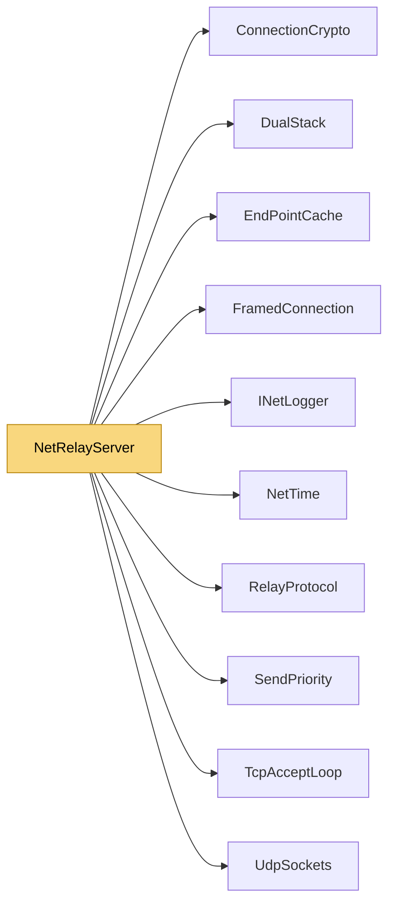

# NetRelayServer

> [!info] Generated by `tools/generate-vault.py` from the source — do not edit by hand; rerun the script after code changes.

Relay (and hole-punching rendezvous) for games and apps hosted behind NAT. A host claims a room; clients join it by the room code; the relay forwards their packets. For UDP it also introduces client and host to each other so they can try a direct path — when both NATs allow it, the relay drops out of the data path entirely. The relay is deliberately dumb: it forwards NetSync packets without understanding them. On connections with a key exchange those packets are authenticated (and optionally encrypted) end to end, so a relay can neither read nor forge traffic — run it anywhere, trust it with nothing but availability. Runs TCP and UDP on one port. Host it as a small service:

**Namespace** `NetSync.Relay` · **Folder** [[Module map Relay|Relay]] · **Layer** Transports

**Source** `src/NetSync/Relay/NetRelayServer.cs`

## Types

| Type | Kind | Summary |
|---|---|---|
| `NetRelayServer` | public sealed class | Relay (and hole-punching rendezvous) for games and apps hosted behind NAT. A host claims a room; clients join it by the room code; the relay forwards their packets. For UDP it also introduces client and host to each… |
| ↳ `Room` | private sealed class |  |
| ↳ `UdpClientRecord` | private sealed class |  |

## Extends / implements

- `NetRelayServer` → `IDisposable`

## Members

**NetRelayServer**

- `public int MaxRooms`
- `public int MaxClientsPerRoom`
- `public bool AllowDirect`
- `public int Port`
- `public int RoomCount`
- `public long RelayedUdpBytes`
- `public long RelayedTcpBytes`
- `public NetRelayServer(INetLogger? logger = null)`
- `public Task<int> StartAsync(int port, CancellationToken ct = default)`
- `public void Stop()`
- `public void Dispose()`

## Depends on (10)

- **Pipeline/Security**: [[ConnectionCrypto]]
- **Transports**: [[DualStack]], [[TcpAcceptLoop]]
- **Transports/Udp**: [[EndPointCache]] (`EndPointCache`, `SocketAddressCache`), [[UdpSockets]]
- **Relay**: [[FramedConnection]], [[RelayProtocol]]
- **Sending**: [[SendPriority]]
- **Diagnostics**: [[INetLogger]] (`INetLogger`, `NullNetLogger`)
- **Internal**: [[NetTime]]

## Used by (0)

—

## Neighbourhood

