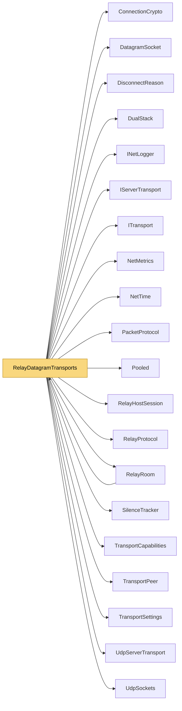

# RelayDatagramTransports

> [!NOTE]
> Generated by `tools/generate-vault.py` from the source — do not edit by hand; rerun the script after code changes.

Client datagram slot through a relay, with UDP hole punching. Registers with the relay (which answers with a client id and the host's public endpoint), sends via the relay at once, and meanwhile punches towards the host. The first datagram straight from the host proves a direct path; from then on traffic bypasses the relay. If the direct path goes quiet, it falls back to the relay and punches again. Datagram payloads are NetSync UDP packets ([type][payload]), so ping/pong and data work exactly as on the plain UDP transport.

**Namespace** `NetSync.Relay` · **Folder** [Relay](../../4%20Diagrams/Modules/Module%20map%20Relay.md) · **Layer** Transports

**Source** `src/NetSync/Relay/RelayDatagramTransports.cs`

## Types

| Type | Kind | Summary |
|---|---|---|
| `RelayDatagramClientTransport` | internal sealed class | Client datagram slot through a relay, with UDP hole punching. Registers with the relay (which answers with a client id and the host's public endpoint), sends via the relay at once, and meanwhile punches towards the… |
| ↳ `Connection` | private sealed class |  |
| `RelayDatagramHostTransport` | internal sealed class | Host datagram slot through a relay: one socket registered with the relay (repeatedly — that keeps the host's NAT mapping open), relayed client traffic arriving tagged with a client id, and direct paths learned from… |
| ↳ `ClientRecord` | private sealed class |  |

## Extends / implements

- `RelayDatagramClientTransport` → `ITransport` ([ITransport](../Transports/ITransport.md))
- `RelayDatagramClientTransport` → `IPooledReceiveTransport` ([TransportCapabilities](../Transports/TransportCapabilities.md))
- `RelayDatagramHostTransport` → `IServerTransport` ([IServerTransport](../Transports/IServerTransport.md))
- `RelayDatagramHostTransport` → `IPooledReceiveServerTransport` ([TransportCapabilities](../Transports/TransportCapabilities.md))
- `RelayDatagramHostTransport` → `ITrustAwareServerTransport` ([TransportCapabilities](../Transports/TransportCapabilities.md))

## Members

**RelayDatagramClientTransport**

- `public bool IsConnected`
- `public int PingMs`
- `internal bool IsDirect`
- `public event Action? Connected`
- `public event Action<DisconnectReason>? Disconnected`
- `public event Action<byte[]>? DataReceived`
- `internal Action<byte[], int, int>? PooledReceive`
- `public RelayDatagramClientTransport(RelayRoom room, TransportSettings settings)`
- `public async Task ConnectAsync(IPEndPoint endpoint, CancellationToken ct = default)`
- `public ValueTask SendAsync(ReadOnlyMemory<byte> data, CancellationToken ct = default)`
- `public ValueTask SendAsync(ReadOnlyMemory<byte> prefix, ReadOnlyMemory<byte> payload, CancellationToken ct = default)`
- `public void Disconnect()`
- `public void Dispose()`

**RelayDatagramHostTransport**

- `public int Port`
- `public bool IsRunning`
- `public event Action<TransportPeer>? PeerConnected`
- `public event Action<TransportPeer, DisconnectReason>? PeerDisconnected`
- `public event Action<TransportPeer, byte[]>? DataReceived`
- `internal Action<TransportPeer, byte[], int, int>? PooledReceive`
- `internal bool RequireTrust`
- `internal bool IgnorePunches`
- `public RelayDatagramHostTransport(RelayRoom room, TransportSettings settings)`
- `public async Task<int> StartAsync(int port, CancellationToken ct = default)`
- `public ValueTask SendAsync(TransportPeer peer, ReadOnlyMemory<byte> data, CancellationToken ct = default)`
- `public ValueTask SendAsync(TransportPeer peer, ReadOnlyMemory<byte> prefix, ReadOnlyMemory<byte> payload, CancellationToken ct = default)`
- `public void DisconnectPeer(TransportPeer peer)`
- `public Task StopAsync()`
- `public void Dispose()`

## Depends on (20)

- **Pipeline/Security**: [ConnectionCrypto](../Pipeline/Security/ConnectionCrypto.md)
- **Transports**: [DisconnectReason](../Transports/DisconnectReason.md), [DualStack](../Transports/DualStack.md), [IServerTransport](../Transports/IServerTransport.md), [ITransport](../Transports/ITransport.md), [PacketProtocol](../Transports/PacketProtocol.md) (`PacketProtocol`, `PacketType`), [SilenceTracker](../Transports/SilenceTracker.md), [TransportCapabilities](../Transports/TransportCapabilities.md) (`IPooledReceiveServerTransport`, `IPooledReceiveTransport`, `ITrustAwareServerTransport`, `ReceivedPacket`), [TransportPeer](../Transports/TransportPeer.md), [TransportSettings](../Transports/TransportSettings.md)
- **Transports/Udp**: [UdpServerTransport](../Transports/Udp/UdpServerTransport.md), [UdpSockets](../Transports/Udp/UdpSockets.md)
- **Relay**: [DatagramSocket](DatagramSocket.md) (`IDatagramSocket`), [RelayHostSession](RelayHostSession.md), [RelayProtocol](RelayProtocol.md), [RelayRoom](RelayRoom.md)
- **Diagnostics**: [INetLogger](../Diagnostics/INetLogger.md), [NetMetrics](../Diagnostics/NetMetrics.md)
- **Internal**: [NetTime](../Internal/NetTime.md), [Pooled](../Internal/Pooled.md)

## Used by (1)

- **Relay**: [RelayRoom](RelayRoom.md) (`RelayDatagramClientTransport`, `RelayDatagramHostTransport`)

## Neighbourhood

