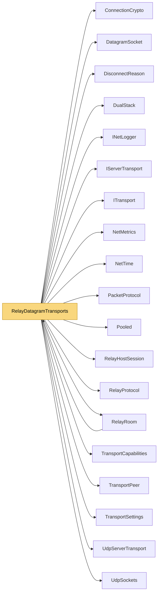

# RelayDatagramTransports

> [!info] Generated by `tools/generate-vault.py` from the source — do not edit by hand; rerun the script after code changes.

Client datagram slot through a relay, with UDP hole punching. Registers with the relay (which answers with a client id and the host's public endpoint), sends via the relay at once, and meanwhile punches towards the host. The first datagram straight from the host proves a direct path; from then on traffic bypasses the relay. If the direct path goes quiet, it falls back to the relay and punches again. Datagram payloads are NetSync UDP packets ([type][payload]), so ping/pong and data work exactly as on the plain UDP transport.

**Namespace** `NetSync.Relay` · **Folder** [[Module map Relay|Relay]] · **Layer** Transports

**Source** `src/NetSync/Relay/RelayDatagramTransports.cs`

## Types

| Type | Kind | Summary |
|---|---|---|
| `RelayDatagramClientTransport` | internal sealed class | Client datagram slot through a relay, with UDP hole punching. Registers with the relay (which answers with a client id and the host's public endpoint), sends via the relay at once, and meanwhile punches towards the… |
| ↳ `Connection` | private sealed class |  |
| `RelayDatagramHostTransport` | internal sealed class | Host datagram slot through a relay: one socket registered with the relay (repeatedly — that keeps the host's NAT mapping open), relayed client traffic arriving tagged with a client id, and direct paths learned from… |
| ↳ `ClientRecord` | private sealed class |  |

## Extends / implements

- `RelayDatagramClientTransport` → `ITransport` ([[ITransport]])
- `RelayDatagramClientTransport` → `IPooledReceiveTransport` ([[TransportCapabilities]])
- `RelayDatagramHostTransport` → `IServerTransport` ([[IServerTransport]])
- `RelayDatagramHostTransport` → `IPooledReceiveServerTransport` ([[TransportCapabilities]])
- `RelayDatagramHostTransport` → `ITrustAwareServerTransport` ([[TransportCapabilities]])

## Members

**RelayDatagramClientTransport**

- `public bool IsConnected`
- `public int PingMs`
- `internal bool IsDirect`
- `public event Action? Connected`
- `public event Action<DisconnectReason>? Disconnected`
- `public event Action<byte[]>? DataReceived`
- `internal Action<byte[], int, int>? PooledReceive`
- `public RelayDatagramClientTransport(RelayRoom room, TransportSettings settings)`
- `public async Task ConnectAsync(IPEndPoint endpoint, CancellationToken ct = default)`
- `public ValueTask SendAsync(ReadOnlyMemory<byte> data, CancellationToken ct = default)`
- `public ValueTask SendAsync(ReadOnlyMemory<byte> prefix, ReadOnlyMemory<byte> payload, CancellationToken ct = default)`
- `public void Disconnect()`
- `public void Dispose()`

**RelayDatagramHostTransport**

- `public int Port`
- `public bool IsRunning`
- `public event Action<TransportPeer>? PeerConnected`
- `public event Action<TransportPeer, DisconnectReason>? PeerDisconnected`
- `public event Action<TransportPeer, byte[]>? DataReceived`
- `internal Action<TransportPeer, byte[], int, int>? PooledReceive`
- `internal bool RequireTrust`
- `internal bool IgnorePunches`
- `public RelayDatagramHostTransport(RelayRoom room, TransportSettings settings)`
- `public async Task<int> StartAsync(int port, CancellationToken ct = default)`
- `public ValueTask SendAsync(TransportPeer peer, ReadOnlyMemory<byte> data, CancellationToken ct = default)`
- `public ValueTask SendAsync(TransportPeer peer, ReadOnlyMemory<byte> prefix, ReadOnlyMemory<byte> payload, CancellationToken ct = default)`
- `public void DisconnectPeer(TransportPeer peer)`
- `public Task StopAsync()`
- `public void Dispose()`

## Depends on (19)

- **Pipeline/Security**: [[ConnectionCrypto]]
- **Transports**: [[DisconnectReason]], [[DualStack]], [[IServerTransport]], [[ITransport]], [[PacketProtocol]] (`PacketProtocol`, `PacketType`), [[TransportCapabilities]] (`IPooledReceiveServerTransport`, `IPooledReceiveTransport`, `ITrustAwareServerTransport`, `ReceivedPacket`), [[TransportPeer]], [[TransportSettings]]
- **Transports/Udp**: [[UdpServerTransport]], [[UdpSockets]]
- **Relay**: [[DatagramSocket]] (`IDatagramSocket`), [[RelayHostSession]], [[RelayProtocol]], [[RelayRoom]]
- **Diagnostics**: [[INetLogger]], [[NetMetrics]]
- **Internal**: [[NetTime]], [[Pooled]]

## Used by (1)

- **Relay**: [[RelayRoom]] (`RelayDatagramClientTransport`, `RelayDatagramHostTransport`)

## Neighbourhood

