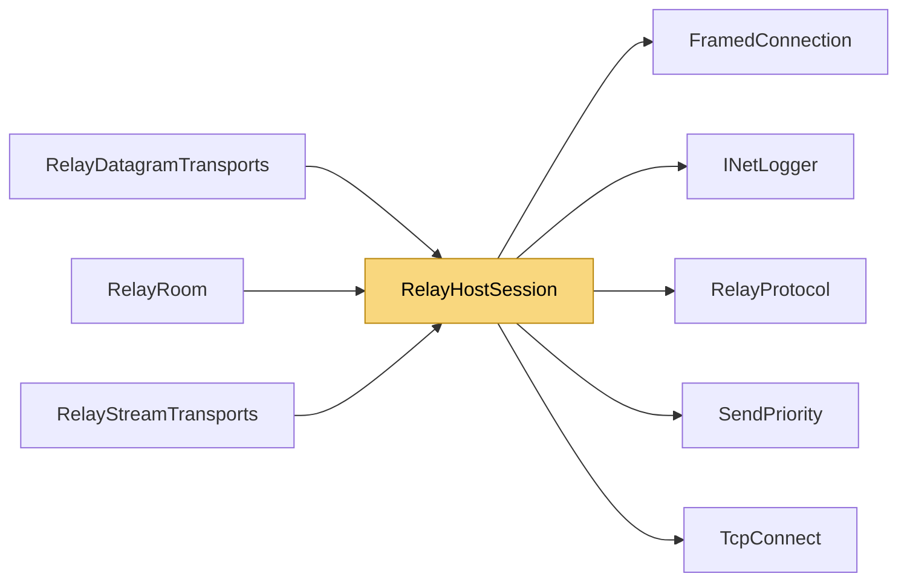

# RelayHostSession

> [!info] Generated by `tools/generate-vault.py` from the source — do not edit by hand; rerun the script after code changes.

A host's control connection to the relay: claims the room, receives the secret that authorizes the host's UDP registration, and multiplexes every stream client (PeerOpen / PeerData / PeerClose) over one TCP connection.

**Namespace** `NetSync.Relay` · **Folder** [[Module map Relay|Relay]] · **Layer** Transports

**Source** `src/NetSync/Relay/RelayHostSession.cs`

## Types

| Type | Kind | Summary |
|---|---|---|
| `RelayHostSession` | internal sealed class | A host's control connection to the relay: claims the room, receives the secret that authorizes the host's UDP registration, and multiplexes every stream client (PeerOpen / PeerData / PeerClose) over one TCP connection. |

## Extends / implements

- `RelayHostSession` → `IDisposable`

## Members

**RelayHostSession**

- `public FramedConnection Connection`
- `public byte[] Secret`
- `public IPEndPoint RelayEndPoint`
- `public bool IsClosed`
- `public Action<uint, IPEndPoint?>? PeerOpened`
- `public Action<uint, byte[], int, int>? PeerData`
- `public Action<uint>? PeerClosed`
- `public void OnClosed(Action callback)`
- `public void RemoveOnClosed(Action callback)`
- `public static async Task<RelayHostSession> ConnectAsync(IPEndPoint relay, string room, INetLogger logger, CancellationToken ct)`
- `public void StartReceiving()`
- `public void Dispose()`

## Depends on (5)

- **Transports**: [[TcpConnect]]
- **Relay**: [[FramedConnection]], [[RelayProtocol]]
- **Sending**: [[SendPriority]]
- **Diagnostics**: [[INetLogger]]

## Used by (3)

- **Relay**: [[RelayDatagramTransports]], [[RelayRoom]], [[RelayStreamTransports]]

## Neighbourhood

