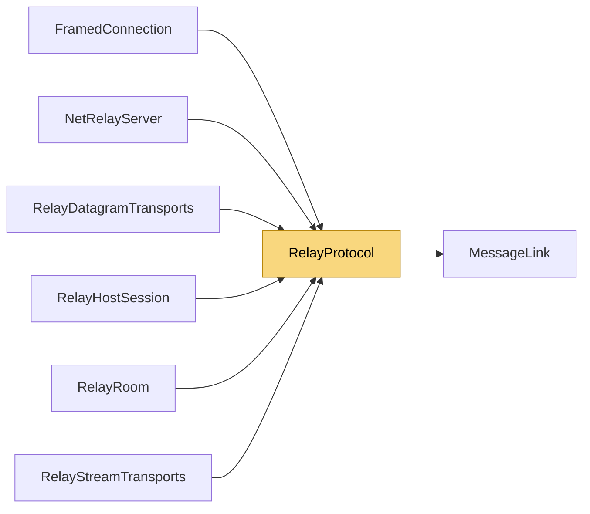

# RelayProtocol

> [!info] Generated by `tools/generate-vault.py` from the source — do not edit by hand; rerun the script after code changes.

Wire format between relay clients/hosts and `NetRelayServer`. The relay never looks inside the NetSync packets it carries ("message" below) — with a key exchange configured they are authenticated envelopes it can't read or forge. TCP frames: [kind:1][bodyLength:4 BE][body] HostHello 0x01 [roomLen:1][room] host claims a room HostWelcome 0x02 [secret:16] room is yours; the secret authorizes your UDP side ClientHello 0x03 [roomLen:1][room] client joins a room's stream side ClientWelcome 0x04 [] Refused 0x05 [reason utf8] Data 0x10 [message] client ⇄ relay PeerData 0x11 [clientId:4][message] relay ⇄ host PeerOpen 0x12 [clientId:4][endpoint] relay → host: a stream client arrived PeerClose 0x13 [clientId:4] either way: that client is gone / kick it Keepalive 0x14 [] UDP datagrams: [kind:1][...] HostRegister 0x80 [roomLen][room][secret:16] host → relay (repeated: keeps NAT mappings) HostRegistered 0x81 [] ClientRegister 0x82 [roomLen][room][nonce:8] client → relay ClientRegistered 0x83 [clientId:4][hostEndpoint] relay → client (endpoint empty: no direct path) Introduce 0x84 [clientId:4][nonce:8][endpoint] relay → host: punch towards this client RelayData 0x85 client→relay [clientId:4][nonce:8][message]; relay→host [clientId:4][message]; host→relay [clientId:4][message]; relay→client [message] Punch 0x86 [clientId:4][nonce:8] client ⇄ host, directly DirectData 0x87 client→host [clientId:4][nonce:8][message]; host→client [message] Endpoint: [family:1 (4|6)][address 4|16][port:2 BE]; family 0 = none.

**Namespace** `NetSync.Relay` · **Folder** [[Module map Relay|Relay]] · **Layer** Transports

**Source** `src/NetSync/Relay/RelayProtocol.cs`

## Types

| Type | Kind | Summary |
|---|---|---|
| `RelayProtocol` | internal static class | Wire format between relay clients/hosts and `NetRelayServer`. The relay never looks inside the NetSync packets it carries ("message" below) — with a key exchange configured they are authenticated envelopes it can't… |

## Members

**RelayProtocol**

- `public const byte HostHello = 0x01`
- `public const byte HostWelcome = 0x02`
- `public const byte ClientHello = 0x03`
- `public const byte ClientWelcome = 0x04`
- `public const byte Refused = 0x05`
- `public const byte Data = 0x10`
- `public const byte PeerData = 0x11`
- `public const byte PeerOpen = 0x12`
- `public const byte PeerClose = 0x13`
- `public const byte Keepalive = 0x14`
- `public const byte HostRegister = 0x80`
- `public const byte HostRegistered = 0x81`
- `public const byte ClientRegister = 0x82`
- `public const byte ClientRegistered = 0x83`
- `public const byte Introduce = 0x84`
- `public const byte RelayData = 0x85`
- `public const byte Punch = 0x86`
- `public const byte DirectData = 0x87`
- `public const int FrameHeaderSize = 5`
- `public const int SecretSize = 16`
- `public const int NonceSize = 8`
- `public const int MaxRoomBytes = 64`
- `public const int MaxFrameBody = Transports.MessageLink.MaxMessage + 16`
- `public static byte[] EncodeRoom(string room)`
- `public static bool TryReadRoom(ReadOnlySpan<byte> source, out string room, out int consumed)`
- `public static int EndPointSize(IPEndPoint? endPoint)`
- `public static int WriteEndPoint(Span<byte> destination, IPEndPoint? endPoint)`
- `public static bool TryReadEndPoint(ReadOnlySpan<byte> source, out IPEndPoint? endPoint, out int consumed)`
- `public static byte[] Frame(byte kind, ReadOnlySpan<byte> body)`

## Depends on (1)

- **Transports**: [[MessageLink]]

## Used by (6)

- **Relay**: [[FramedConnection]], [[NetRelayServer]], [[RelayDatagramTransports]], [[RelayHostSession]], [[RelayRoom]], [[RelayStreamTransports]]

## Neighbourhood

