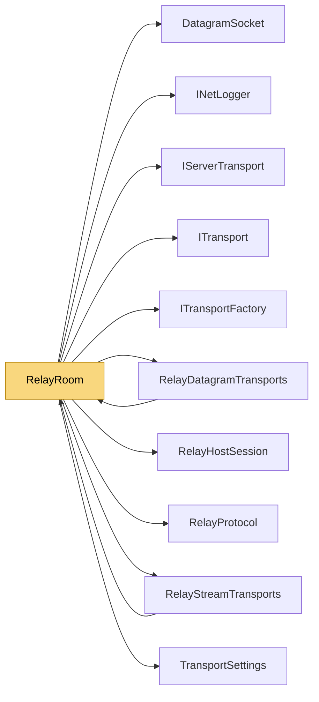

# RelayRoom

> [!info] Generated by `tools/generate-vault.py` from the source — do not edit by hand; rerun the script after code changes.

A room on a `NetRelayServer`: the way to reach a server behind NAT. Host — keep accepting LAN clients directly, add the relay as extra listeners: Client — same channels, the relay's address, the room code: The UDP side tries a direct, hole-punched path first (`AllowDirect`) and stays on the relay when the NATs don't allow one; the stream side always goes through the relay (TCP can't be hole-punched reliably). To take all traffic off the relay, configure only UDP channels — ReliableOrdered UDP replaces a TCP channel — and register only `Udp`. Encryption and authentication stay end to end — the relay only sees envelopes. A host that loses the relay (relay restart, network outage) keeps reclaiming its room in the background, with growing pauses up to `MaxReconnectDelayMs`; clients that were connected through the relay reconnect on their own (`Reconnect`).

**Namespace** `NetSync.Relay` · **Folder** [[Module map Relay|Relay]] · **Layer** Transports

**Source** `src/NetSync/Relay/RelayRoom.cs`

## Types

| Type | Kind | Summary |
|---|---|---|
| `RelayRoom` | public sealed class | A room on a `NetRelayServer`: the way to reach a server behind NAT. Host — keep accepting LAN clients directly, add the relay as extra listeners: Client — same channels, the relay's address, the room code: The UDP… |
| ↳ `StreamFactory` | private sealed class |  |
| ↳ `DatagramFactory` | private sealed class |  |

## Members

**RelayRoom**

- `public const int MaxReconnectDelayMs = 30_000`
- `public RelayRoom(string roomId)`
- `public static string NewRoomCode(int length = 6)`
- `public string RoomId`
- `public IPEndPoint? RelayEndPoint`
- `public bool AllowDirect`
- `public ITransportFactory Tcp`
- `public ITransportFactory Udp`
- `internal Func<AddressFamily, IDatagramSocket> SocketFactory`
- `internal IPEndPoint RequireRelayEndPoint()`
- `internal event Action<RelayHostSession>? HostSessionRestored`
- `internal Task<RelayHostSession> AcquireHostSessionAsync(INetLogger logger, CancellationToken ct)`
- `internal void ReleaseHostSession()`

## Depends on (10)

- **Transports**: [[IServerTransport]], [[ITransport]], [[ITransportFactory]], [[TransportSettings]]
- **Relay**: [[DatagramSocket]] (`DatagramSocket`, `IDatagramSocket`), [[RelayDatagramTransports]] (`RelayDatagramClientTransport`, `RelayDatagramHostTransport`), [[RelayHostSession]], [[RelayProtocol]], [[RelayStreamTransports]] (`RelayStreamClientTransport`, `RelayStreamHostTransport`)
- **Diagnostics**: [[INetLogger]]

## Used by (2)

- **Relay**: [[RelayDatagramTransports]], [[RelayStreamTransports]]

## Neighbourhood

