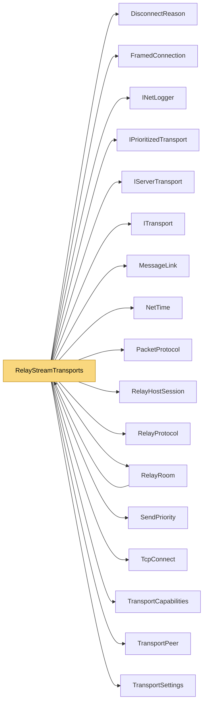

# RelayStreamTransports

> [!info] Generated by `tools/generate-vault.py` from the source — do not edit by hand; rerun the script after code changes.

Client stream slot through a relay: one TCP connection, NetSync packets as Data frames.

**Namespace** `NetSync.Relay` · **Folder** [[Module map Relay|Relay]] · **Layer** Transports

**Source** `src/NetSync/Relay/RelayStreamTransports.cs`

## Types

| Type | Kind | Summary |
|---|---|---|
| `RelayStreamClientTransport` | internal sealed class | Client stream slot through a relay: one TCP connection, NetSync packets as Data frames. |
| ↳ `Connection` | private sealed class |  |
| `RelayStreamHostTransport` | internal sealed class | Host stream slot through a relay: every stream client of the room is a peer, multiplexed over the host's single control connection. |
| ↳ `PeerState` | private sealed class |  |

## Extends / implements

- `RelayStreamClientTransport` → `ITransport` ([[ITransport]])
- `RelayStreamClientTransport` → `IPrioritizedTransport` ([[IPrioritizedTransport]])
- `RelayStreamClientTransport` → `IPooledReceiveTransport` ([[TransportCapabilities]])
- `RelayStreamHostTransport` → `IServerTransport` ([[IServerTransport]])
- `RelayStreamHostTransport` → `IPrioritizedServerTransport` ([[IPrioritizedTransport]])

## Members

**RelayStreamClientTransport**

- `public bool IsConnected`
- `public int PingMs`
- `public event Action? Connected`
- `public event Action<DisconnectReason>? Disconnected`
- `public event Action<byte[]>? DataReceived`
- `internal Action<byte[], int, int>? PooledReceive`
- `public RelayStreamClientTransport(RelayRoom room, TransportSettings settings)`
- `public async Task ConnectAsync(IPEndPoint endpoint, CancellationToken ct = default)`
- `public ValueTask SendAsync(ReadOnlyMemory<byte> data, CancellationToken ct = default)`
- `public ValueTask SendAsync(ReadOnlyMemory<byte> prefix, ReadOnlyMemory<byte> payload, CancellationToken ct = default)`
- `public ValueTask SendAsync(ReadOnlyMemory<byte> prefix, ReadOnlyMemory<byte> payload, SendPriority priority, CancellationToken ct = default)`
- `public void Disconnect()`
- `public void Dispose()`

**RelayStreamHostTransport**

- `public int Port`
- `public bool IsRunning`
- `public event Action<TransportPeer>? PeerConnected`
- `public event Action<TransportPeer, DisconnectReason>? PeerDisconnected`
- `public event Action<TransportPeer, byte[]>? DataReceived`
- `internal Action<TransportPeer, byte[], int, int>? PooledReceive`
- `internal bool RequireTrust`
- `public RelayStreamHostTransport(RelayRoom room, TransportSettings settings)`
- `public async Task<int> StartAsync(int port, CancellationToken ct = default)`
- `public ValueTask SendAsync(TransportPeer peer, ReadOnlyMemory<byte> data, CancellationToken ct = default)`
- `public ValueTask SendAsync(TransportPeer peer, ReadOnlyMemory<byte> prefix, ReadOnlyMemory<byte> payload, CancellationToken ct = default)`
- `public ValueTask SendAsync(TransportPeer peer, ReadOnlyMemory<byte> prefix, ReadOnlyMemory<byte> payload, SendPriority priority, CancellationToken ct = default)`
- `public void DisconnectPeer(TransportPeer peer)`
- `public Task StopAsync()`
- `public void Dispose()`

## Depends on (17)

- **Transports**: [[DisconnectReason]], [[IPrioritizedTransport]] (`IPrioritizedServerTransport`, `IPrioritizedTransport`), [[IServerTransport]], [[ITransport]], [[MessageLink]], [[PacketProtocol]], [[TcpConnect]], [[TransportCapabilities]] (`IPooledReceiveServerTransport`, `IPooledReceiveTransport`, `ITrustAwareServerTransport`, `ReceivedPacket`), [[TransportPeer]], [[TransportSettings]]
- **Relay**: [[FramedConnection]], [[RelayHostSession]], [[RelayProtocol]], [[RelayRoom]]
- **Sending**: [[SendPriority]]
- **Diagnostics**: [[INetLogger]]
- **Internal**: [[NetTime]]

## Used by (1)

- **Relay**: [[RelayRoom]] (`RelayStreamClientTransport`, `RelayStreamHostTransport`)

## Neighbourhood

